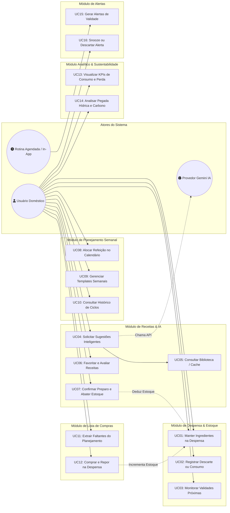
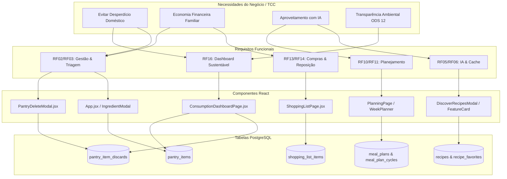
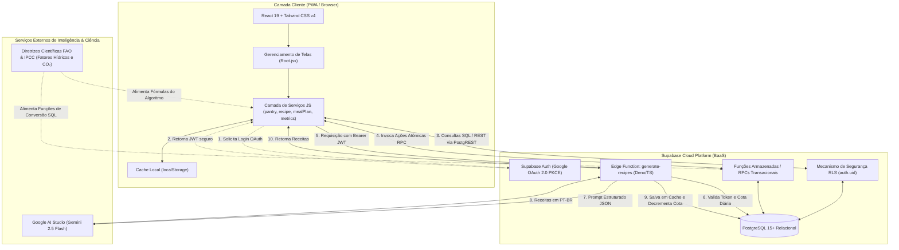
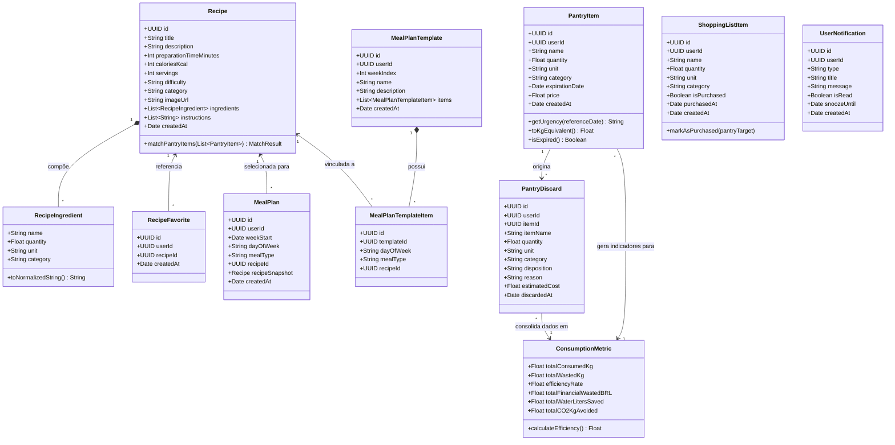
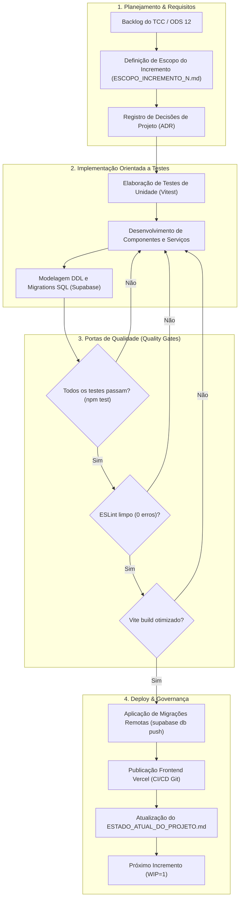
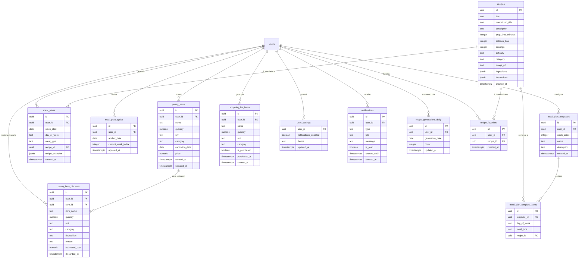

# SMART PANTRY: Sistema Inteligente e Sustentável de Gestão de Despensa Doméstica, Planejamento Alimentar e Mitigação do Desperdício

**Documento de Consolidação Técnica e Arquitetural para o Trabalho de Conclusão de Curso (TCC)**

* **Autor / Responsável Técnico:** Gustavo Bongiovani
* **Repositório:** [github.com/bongiovanii/Smart-Pantry](https://github.com/bongiovanii/Smart-Pantry)
* **Data de Consolidação:** Novembro de 2026
* **Versão Consolidada:** 3.0 (Cobre os Incrementos 1 a 10 e Fases 1 a 12)
* **Alinhamento Institucional:** Objetivos de Desenvolvimento Sustentável da Organização das Nações Unidas — **ODS 12 (Consumo e Produção Responsáveis)**

---

## Sumário
1. [Capítulo 1: Introdução, Fundamentação & Visão do Produto](#capítulo-1-introdução-fundamentação--visão-do-produto)
2. [Capítulo 2: Engenharia de Requisitos & Casos de Uso](#capítulo-2-engenharia-de-requisitos--casos-de-uso)
3. [Capítulo 3: Arquitetura de Software & Diagramas Estruturais](#capítulo-3-arquitetura-de-software--diagramas-estruturais)
4. [Capítulo 4: Engenharia de Dados & Persistência Relacional](#capítulo-4-engenharia-de-dados--persistência-relacional)
5. [Capítulo 5: Algoritmos, Métricas & Modelagem Científica](#capítulo-5-algoritmos-métricas--modelagem-científica)
6. [Capítulo 6: Histórico Evolutivo dos Incrementos (1 ao 10)](#capítulo-6-histórico-evolutivo-dos-incrementos-1-ao-10)
7. [Capítulo 7: Estratégia de Qualidade, Testes & Validação](#capítulo-7-estratégia-de-qualidade-testes--validação)
8. [Capítulo 8: Conclusão, Resultados & Trabalhos Futuros](#capítulo-8-conclusão-resultados--trabalhos-futuros)

---

# Capítulo 1: Introdução, Fundamentação & Visão do Produto

## 1.1 Contexto e Justificativa Socioambiental
O desperdício de alimentos é um dos desafios econômicos e ecológicos mais críticos da contemporaneidade. De acordo com a *Food and Agriculture Organization (FAO)* das Nações Unidas e dados do *Food Waste Index* do Programa das Nações Unidas para o Meio Ambiente (PNUMA), estima-se que cerca de um terço de toda a comida produzida no planeta para consumo humano seja perdida ou desperdiçada ao longo da cadeia produtiva e de consumo, totalizando aproximadamente 1,3 bilhão de toneladas anuais.

No contexto doméstico dos lares urbanos, as causas preponderantes do descarte precoce incluem:
1. **Falta de visibilidade do estoque:** Alimentos guardados no fundo de prateleiras ou gavetas da geladeira que ultrapassam o prazo de validade sem que os moradores percebam.
2. **Dificuldade na combinação culinária de sobras:** Ausência de repertório prático para transformar pequenos volumes remanescentes (ex.: sobras de arroz cozido, talos de hortaliças, cascas e vegetais maduros) em pratos atrativos e nutritivos.
3. **Ausência de planejamento integrado de compras e refeições:** Compras por impulso sem conciliação com o cardápio semanal, gerando superabundância de perecíveis.
4. **Desconexão com o impacto ambiental:** Os indivíduos raramente possuem dimensão tangível da pegada hídrica e das emissões de gases de efeito estufa embutidas nos alimentos descartados no lixo comum.

## 1.2 Alinhamento ao ODS 12 da ONU
O projeto **Smart Pantry** foi concebido como uma intervenção sociotécnica estruturada diretamente para atender à **Meta 12.3 dos Objetivos de Desenvolvimento Sustentável (ODS 12 — Consumo e Produção Responsáveis)**:
> *"Até 2030, reduzir pela metade o desperdício de alimentos per capita mundial, nos níveis de varejo e do consumidor, e reduzir as perdas de alimentos ao longo das cadeias de produção e abastecimento."*

A aplicação transforma essa diretriz em rotinas computacionais automatizadas: monitoramento de validade com alerta proativo, sugestão inteligente de receitas de aproveitamento integral baseadas no que existe em estoque, triagem consciente de descartes versus consumo real, e quantificação científica do impacto ecológico (litros de água poupados e $CO_2$ evitado).

## 1.3 Visão do Produto e Proposta de Valor
O **Smart Pantry** é uma aplicação *Progressive Web App (PWA)* responsiva, mobile-first, orientada a dados e assistida por Inteligência Artificial generativa, que unifica a gestão da despensa, o planejamento semanal de cardápios, a lista de compras reativa e a conscientização ambiental.

### Proposta de Valor Central:
* **Para a Família:** Economia financeira mensurável (reduzindo compras duplicadas e perdas de alimentos pagos), organização simplificada sem complexidade de planilhas e refeições saudáveis com afeto e sabor.
* **Para o Meio Ambiente:** Mitigação comprovada do descarte orgânico em aterros sanitários e redução da demanda hídrica e pegada de carbono domésticas.
* **Para a Engenharia de Software:** Um ecossistema moderno, desacoplado, modular, de alta fidelidade técnica, seguro via *Row Level Security (RLS)* e com geração de IA estruturada (*JSON Schema*) sob restrição de cotas e cache-first.

---

# Capítulo 2: Engenharia de Requisitos & Casos de Uso

## 2.1 Requisitos Funcionais (RF)

| ID | Nome do Requisito | Descrição Técnica | Módulo |
|---|---|---|---|
| **RF01** | Autenticação Federada Google | Autenticar usuários exclusivamente via Google OAuth 2.0 com fluxo seguro PKCE, mantendo sessão persistente em JWT. | Identidade |
| **RF02** | Gestão de Itens da Despensa | Cadastrar, listar, editar e excluir ingredientes da despensa com nome, quantidade, unidade heterogênea, categoria, data de validade e preço opcional. | Despensa |
| **RF03** | Triagem de Descarte / Baixa | Ao dar baixa em um item da despensa, registrar se o alimento foi consumido, descartado por validade/avaria ou excluído por engano. | Despensa / Métricas |
| **RF04** | Monitoramento de Validade | Identificar itens vencendo em até 3 dias e itens já vencidos, categorizando níveis de urgência visual. | Despensa / Alertas |
| **RF05** | Sugestão de Receitas por IA | Chamar a API Gemini 2.5 Flash via Edge Function para gerar receitas em PT-BR baseadas nos ingredientes da despensa com saída JSON estruturada. | Receitas |
| **RF06** | Biblioteca de Receitas e Cache-First | Armazenar receitas geradas no banco relacional; buscar primeiro na base existente antes de solicitar novas gerações à IA para economizar tokens. | Receitas |
| **RF07** | Controle de Cota de IA | Limitar cada usuário a no máximo 10 gerações de receitas por IA por dia através de controle atômico em banco de dados. | Receitas / Governança |
| **RF08** | Favoritos e Curadoria | Permitir favoritar/desfavoritar receitas de forma reativa e visualizá-las em aba dedicada com filtros e busca textual. | Receitas |
| **RF09** | Abate Automático por Cozimento | Ao confirmar o preparo de uma receita, deduzir automaticamente as quantidades necessárias do estoque da despensa via transação. | Movimentações |
| **RF10** | Planejamento Semanal Persistente | Alocar receitas para os 7 dias da semana (Segunda a Domingo) em 4 turnos (Café, Almoço, Lanche, Jantar) com suporte a múltiplos ciclos. | Planejamento |
| **RF11** | Templates de Planejamento | Criar até 4 templates semanais reutilizáveis e permitir a aplicação atômica de um template sobre a semana ativa. | Planejamento |
| **RF12** | Histórico de Semanas e Ciclos | Gravar snapshots das semanas planejadas e consumidas organizadas em ciclos de 4 semanas. | Planejamento |
| **RF13** | Lista de Compras Inteligente | Gerenciar itens a comprar, com sugestões automáticas baseadas em itens ausentes no plano semanal e itens frequentes com estoque baixo. | Compras |
| **RF14** | Reposição Automática na Despensa | Ao marcar um item da lista de compras como adquirido, inseri-lo ou incrementá-lo automaticamente no estoque da despensa. | Compras / Despensa |
| **RF15** | Notificações In-App de Vencimento | Gerar alertas dentro da aplicação para itens em risco, permitindo leitura, descarte ou snooze (adiar notificação por 24h). | Notificações |
| **RF16** | Dashboard Analítico e Impacto FAO | Exibir KPIs de consumo, valor financeiro desperdiçado (R$), taxa de eficiência (%), histórico semanal, donut de categorias e impacto ecológico (Água doce e $CO_2$). | Métricas / ODS 12 |

## 2.2 Requisitos Não-Funcionais (RNF)

| ID | Categoria | Descrição | Critério de Aceitação / Métrica |
|---|---|---|---|
| **RNF01** | Segurança | Isolamento absoluto de dados entre usuários (*Multi-tenancy* lógico). | Políticas de *Row Level Security (RLS)* no PostgreSQL para todas as tabelas via `auth.uid() = user_id`. |
| **RNF02** | Desempenho | Tempo de carregamento inicial e transição entre abas. | Build do Vite com *code-splitting* em chunks < 500 KB; primeiro render < 1,5s em conexão móvel 4G. |
| **RNF03** | Responsividade | Interface utilizável em dispositivos móveis e desktops. | PWA *Mobile-first* com barra de navegação inferior no mobile e sidebar lateral a partir de 1024px (*Tailwind CSS v4*). |
| **RNF04** | Custo Operacional | Utilização sustentável de APIs de IA de terceiros. | *Cache-first* local e limite diário rígido de 10 chamadas/dia por usuário, garantindo permanência no tier gratuito do Google AI Studio. |
| **RNF05** | Integridade Transacional | Consistência em operações compostas (ex: abater estoque ao cozinhar, aplicar template, comprar item). | Funções RPC em PostgreSQL com blocos transacionais `BEGIN ... COMMIT/ROLLBACK`. |
| **RNF06** | Usabilidade & Acessibilidade | Conformidade visual e semântica com padrões da web. | Contrastes em conformidade WCAG AA, tags semânticas HTML5, atributos ARIA e fontes legíveis (`Inter` e `Fraunces`). |
| **RNF07** | Manutenibilidade | Separação estrita de camadas e cobertura de testes. | Camada de serviços e utilitários isolada da UI; 100% dos testes unitários críticos passando no Vitest com zero warnings no ESLint. |
| **RNF08** | Robustez a Falhas | Degradação graciosa em indisponibilidade de serviços externos. | Fallback para imagens padrão e cache local quando a IA ou endpoints de rede falharem. |

---

## 2.3 Diagrama de Casos de Uso do Sistema



---

## 2.4 Especificação Detalhada de Casos de Uso Críticos

### Especificação UC04: Solicitar Sugestões Inteligentes de Receitas (com Cache-First)
* **Ator Principal:** Usuário Doméstico Autenticado.
* **Atores Secundários:** Provedor Gemini IA (Google AI Studio), Banco PostgreSQL (Tabela `recipes`).
* **Pré-condições:** O usuário possui sessão válida via Google OAuth e ao menos 1 ingrediente cadastrado na despensa.
* **Fluxo Principal:**
  1. O usuário aciona a ação de descoberta ou botão *"Gerar novas com IA"*.
  2. O frontend coleta os ingredientes disponíveis em estoque e normaliza seus títulos e categorias.
  3. O serviço verifica no banco de dados local (`recipes`) se já existem receitas compatíveis com os ingredientes disponíveis (*Cache-First*).
  4. Se houver receitas suficientes em cache, o sistema as recupera imediatamente sem gastar cotas de IA.
  5. Se o usuário solicitar novas receitas ou não houver correspondência, o sistema valida a cota diária na tabela `recipe_generations_daily` (máximo de 10 gerações/dia).
  6. A Edge Function `generate-recipes` é invocada passando o token JWT e a lista de alimentos.
  7. O Gemini 2.5 Flash processa a requisição usando *Structured Outputs* (JSON Schema estrito em PT-BR) e retorna até 6 receitas viáveis.
  8. A Edge Function persiste as novas receitas no banco de dados para alimentar o cache futuro e decrementa a cota restante.
  9. O frontend exibe os cartões com foto, tempo de preparo, calorias, rendimento e ingredientes compatíveis.
* **Fluxos Alternativos:**
  * **FA01 (Limite diário esgotado):** Se a cota diária for 0, o sistema bloqueia a chamada ao Gemini, exibe badge informativo e oferece receitas da biblioteca interna já armazenadas.
  * **FA02 (Falha de conexão com a IA / Timeout):** O sistema exibe mensagem amigável e apresenta receitas estáticas da culinária regional brasileira salvas localmente.
* **Pós-condições:** Receitas apresentadas na interface e salvas no banco de dados com autorização de uso no planejamento semanal.

### Especificação UC07: Confirmar Preparo de Receita e Abater Estoque
* **Ator Principal:** Usuário Doméstico Autenticado.
* **Pré-condições:** Receita selecionada contendo lista de ingredientes quantificados.
* **Fluxo Principal:**
  1. O usuário abre o modal de preparo de receita e revisa a correspondência entre os ingredientes da receita e o estoque.
  2. O usuário pode ajustar manualmente as quantidades que realmente utilizou.
  3. O usuário clica em *"Confirmar consumo"*.
  4. O frontend aciona a RPC transacional `consume_recipe_ingredients`.
  5. O banco inicia uma transação atômica (`BEGIN`):
     - Para cada ingrediente correspondido, reduz a quantidade em `pantry_items`.
     - Se a quantidade remanescente for zero, remove o item ou altera status para consumido.
     - Registra uma movimentação em `pantry_item_discards` com disposição `'consumed'`.
     - Registra o evento no histórico de receitas preparadas.
  6. A transação é finalizada com sucesso (`COMMIT`).
  7. A interface atualiza o contador do estoque, reflete o novo saldo e notifica o usuário com feedback visual.
* **Pós-condições:** Estoque da despensa atualizado e dados históricos computados para o cálculo de eficiência e economia de alimentos.

---

## 2.5 Matriz de Rastreabilidade de Requisitos

A matriz abaixo estabelece a rastreabilidade bidirecional entre as necessidades do projeto, os requisitos funcionais, os casos de uso, os componentes React de interface e a camada de persistência:



| Requisito Funcional | Caso de Uso | Camada de Apresentação (React) | Camada de Serviços | Tabelas do PostgreSQL / RPCs |
|---|---|---|---|---|
| **RF01** | UC_Auth | `Root.jsx`, `LoginScreen.jsx` | `auth.js` | `auth.users`, `user_settings` |
| **RF02, RF04** | UC01, UC03 | `App.jsx`, `IngredientModal.jsx` | `pantry.js` | `pantry_items` |
| **RF03** | UC02 | `PantryDeleteModal.jsx` | `pantry.js` | `pantry_item_discards`, `record_pantry_discard` |
| **RF05, RF06, RF07** | UC04, UC05 | `DiscoverRecipesModal.jsx`, `FeatureCard.jsx` | `recipe.js`, `recipeLibrary.js` | `recipes`, `recipe_generations_daily`, Edge Fn |
| **RF08** | UC06 | `FavoriteButton.jsx`, `MyRecipesPage.jsx` | `recipeLibrary.js` | `recipe_favorites` |
| **RF09** | UC07 | `CookRecipeModal.jsx` | `movements.js` | `consume_recipe_ingredients`, `pantry_items` |
| **RF10, RF11, RF12** | UC08, UC09, UC10 | `PlanningPage.jsx`, `WeekPlanner.jsx`, `TemplateModal.jsx` | `mealPlan.js` | `meal_plans`, `meal_plan_cycles`, `meal_plan_templates` |
| **RF13, RF14** | UC11, UC12 | `ShoppingListPage.jsx`, `PurchaseItemModal.jsx` | `shoppingList.js` | `shopping_list_items`, `record_pantry_entry` |
| **RF15** | UC15, UC16 | `NotificationsPanel.jsx`, `AppHeader.jsx` | `notifications.js` | `notifications`, `generate_expiration_notifications` |
| **RF16** | UC13, UC14 | `ConsumptionDashboardPage.jsx`, `EcoImpactCard.jsx` | `consumptionDashboard.js`, `consumptionMetrics.js` | `get_consumption_dashboard_data`, `pantry_item_discards` |

---

# Capítulo 3: Arquitetura de Software & Diagramas Estruturais

## 3.1 Padrão Arquitetural Adotado
A arquitetura do **Smart Pantry** baseia-se no modelo **Client-Server Desacoplado baseado em Microsserviços e BaaS (Backend-as-a-Service)** com os seguintes princípios:
1. **Frontend Desacoplado (*Single Page Application / PWA*):** Desenvolvido em React 19 e empacotado via Vite. Toda a interface opera de forma assíncrona, executando cálculos cosméticos no cliente e confiando regras de negócio críticas e transações a funções armazenadas em banco ou borda (*Edge*).
2. **Camada de Borda Segura (*Supabase Edge Functions / Deno*):** Atua como barreira de proteção de credenciais. A chave de API do Google AI Studio jamais é exposta ao navegador; a Edge Function valida o JWT do usuário, aplica controle de cota e conecta-se ao Gemini.
3. **Persistência Confiável com Segurança Centralizada (*PostgreSQL + RLS*):** Em vez de construir uma camada intermediária de API tradicional (como Express ou NestJS) sujeita a falhas de autorização de rotas, a segurança de leitura e escrita é tratada nativamente dentro do banco através de políticas declarativas de *Row Level Security*.
4. **Resiliência e Desempenho (*Cache-First & SVG Nativo*):** As receitas geradas são cacheadas em banco para evitar custos repetitivos de IA. Os gráficos do dashboard são renderizados com SVG puro inline, sem adicionar bibliotecas com sobrecarga de *bundle*.

---

## 3.2 Diagrama Geral do Sistema (Conexão das Stacks & Fluxo de Dados)

O diagrama abaixo ilustra a integração completa de ponta a ponta entre o cliente, a camada de autenticação, a função de borda, o provedor de IA e a base relacional:



---

## 3.3 Diagrama de Classes de Domínio

O diagrama a seguir detalha o modelo lógico de objetos e estruturas manipuladas pelo sistema:



---

## 3.4 Ciclo de Vida do Software & Metodologia de Desenvolvimento

O projeto foi executado sob uma metodologia **Iterativa e Incremental**, combinada com os preceitos do **Kanban com Limite de Trabalho em Progresso (WIP = 1)** para desenvolvimento individual. Cada etapa avançou através de portas de qualidade obrigatórias (*Quality Gates*) antes da promoção para produção:



---

## 3.5 Registro de Decisões de Projeto (ADRs Consolidadas)

As decisões de engenharia foram documentadas ao longo da evolução do software para assegurar rastreabilidade técnica e justificativa de cada escolha:

* **ADR-01 — Adoção de PWA com React e Vite:** Escolheu-se PWA responsivo em detrimento de desenvolvimento móvel nativo precoce (React Native/Flutter) para permitir acesso multiplataforma universal e acelerar a entrega do MVP acadêmico.
* **ADR-02 — Autenticação Exclusiva via Google OAuth 2.0 (PKCE):** A criação de usuários anônimos foi descontinuada no Incremento 3. A exigência de login via Google garante identificação segura, mitiga contas spam e protege cotas de IA sem a complexidade de gerenciar recuperação de senhas locais.
* **ADR-03 — Migração de Spoonacular para Google AI Studio (Gemini 2.5 Flash):** O motor Spoonacular possuía limitações severas de tradução, receitas com ingredientes norte-americanos e cota de 150 pontos/dia. O Gemini oferece suporte nativo impecável ao Português do Brasil (PT-BR), ingredientes típicos da feira brasileira e ampla cota gratuita de 1.500 req/dia.
* **ADR-04 — Uso de *Structured Outputs* (JSON Schema estrito):** Para evitar que a IA retorne texto livre ou JSON quebrado que causaria falhas no parser do frontend, a Edge Function impõe um schema rigoroso exigindo título, ingredientes estruturados com unidades padronizadas, calorias, passos e tempo.
* **ADR-05 — Mecanismo Cache-First para Receitas:** Redução drástica de chamadas à IA. O sistema consulta primeiro a base de dados relacional (`recipes`) para reaproveitar sugestões anteriores.
* **ADR-06 — Limite Atômico de 10 Gerações Diárias por Usuário:** Implementado na tabela `recipe_generations_daily` com trava transacional, prevenindo abusos de cotas e garantindo previsibilidade de custos.
* **ADR-07 — Isolamento de Dados por *Row Level Security (RLS)*:** Todas as tabelas têm RLS ativado por padrão. Usuários só enxergam e alteram registros associados ao seu `auth.uid()`, eliminando o risco de vazamento de dados em nível de banco.
* **ADR-08 — Gráficos em SVG Nativo sem Bibliotecas Externas:** No Incremento 10, gráficos de barras com linha de tendência de Bézier e gráfico Donut foram implementados em SVG puro inline com Tailwind, economizando mais de 200 KB no pacote da aplicação e garantindo responsividade instantânea.
* **ADR-09 — Modelo de Ciclo Semanal Recorrente de 4 Semanas:** O planejamento alimentar organiza-se em blocos modulares de 4 semanas com templates intercambiáveis, permitindo rotação saudável de cardápios sem sobrecarregar o usuário.
* **ADR-10 — Lista de Compras com Reposição Automática na Despensa:** Ao marcar um item como comprado na lista, a RPC `record_pantry_entry` transfere o alimento automaticamente para o estoque, encerrando o ciclo de abastecimento.
* **ADR-11 — Triagem Tripla de Descarte de Alimentos:** Ao remover um alimento da despensa, o usuário informa se foi consumido (`consumed`), descartado por validade (`wasted`) ou erro de digitação (`mistake`), assegurando que apenas descartes reais entrem na métrica de desperdício do TCC.
* **ADR-12 — Precificação Mista (Preço Real Pago + Cesta Média CEAGESP/IBGE):** O cálculo do valor desperdiçado utiliza prioritariamente o preço informado no cadastro da compra; caso ausente, aplica a média de mercado da categoria alimentar.
* **ADR-13 — Notificações In-App em Vez de Web Push Prévio:** Notificações in-app centralizadas no banco de dados e badge no header foram priorizadas no MVP para evitar permissões intrusivas de navegador e dependência de chaves VAPID.
* **ADR-14 — Identidade Visual com Humanismo, Minimalismo e Natureza:** Redesenho completo da landing page e estados de carregamento utilizando paleta orgânica (`#154212`, `#FBFBF7`), tipografia com serifa humanista (`Fraunces`) e fotografias autênticas de culinária sustentável sem desperdício.

---

# Capítulo 4: Engenharia de Dados & Persistência Relacional

## 4.1 Diagrama Entidade-Relacionamento (ERD)



---

## 4.2 Esquema Físico do Banco de Dados Relacional

Abaixo estão especificadas as definições das principais tabelas relacionais do sistema em PostgreSQL:

### Tabela: `public.pantry_items` (Itens em Estoque)
```sql
create table public.pantry_items (
  id uuid primary key default gen_random_uuid(),
  user_id uuid not null references auth.users(id) on delete cascade,
  name text not null,
  quantity numeric(10, 2) not null check (quantity > 0),
  unit text not null check (unit in ('un', 'g', 'kg', 'ml', 'l', 'pacote', 'caixa', 'lata')),
  category text not null check (category in ('Hortifrúti', 'Mercearia', 'Laticínios', 'Carnes e Peixes', 'Panificação', 'Bebidas', 'Outros')),
  expiration_date date not null,
  price numeric(10, 2) check (price is null or price >= 0),
  created_at timestamptz not null default now(),
  updated_at timestamptz not null default now()
);

create index idx_pantry_items_user_exp on public.pantry_items (user_id, expiration_date asc);
alter table public.pantry_items enable row level security;
create policy "Usuários acessam apenas seus próprios itens" on public.pantry_items
  for all using (auth.uid() = user_id) with check (auth.uid() = user_id);
```

### Tabela: `public.pantry_item_discards` (Registro de Baixas e Descartes)
```sql
create table public.pantry_item_discards (
  id uuid primary key default gen_random_uuid(),
  user_id uuid not null references auth.users(id) on delete cascade,
  item_id uuid references public.pantry_items(id) on delete set null,
  item_name text not null,
  quantity numeric(10, 2) not null check (quantity > 0),
  unit text not null,
  category text not null,
  disposition text not null check (disposition in ('consumed', 'wasted', 'mistake')),
  reason text,
  estimated_cost numeric(10, 2) not null default 0 check (estimated_cost >= 0),
  discarded_at timestamptz not null default now()
);

create index idx_pantry_discards_user_date on public.pantry_item_discards (user_id, discarded_at desc);
alter table public.pantry_item_discards enable row level security;
create policy "Usuários gerenciam seus próprios descartes" on public.pantry_item_discards
  for all using (auth.uid() = user_id) with check (auth.uid() = user_id);
```

### Tabela: `public.recipes` (Biblioteca de Receitas em Cache)
```sql
create table public.recipes (
  id uuid primary key default gen_random_uuid(),
  title text not null,
  normalized_title text not null,
  description text not null,
  prep_time_minutes integer not null check (prep_time_minutes > 0),
  calories_kcal integer check (calories_kcal is null or calories_kcal >= 0),
  servings integer not null check (servings > 0),
  difficulty text not null check (difficulty in ('Fácil', 'Média', 'Difícil')),
  category text not null default 'Geral',
  image_url text,
  ingredients jsonb not null default '[]'::jsonb,
  instructions jsonb not null default '[]'::jsonb,
  created_at timestamptz not null default now()
);

create index idx_recipes_normalized_title on public.recipes (normalized_title);
alter table public.recipes enable row level security;
create policy "Receitas são públicas para leitura autenticada" on public.recipes
  for select using (auth.role() = 'authenticated');
```

---

## 4.3 Procedimentos Armazenados e RPCs Transacionais

Para assegurar consistência estrita dos dados (propriedades ACID), operações que afetam múltiplas entidades foram encapsuladas em funções PL/pgSQL no banco:

* `public.consume_recipe_ingredients(p_recipe_id uuid, p_servings integer)`: Abate atômico de ingredientes por porção preparada.
* `public.record_pantry_discard(p_item_id uuid, p_disposition text, p_reason text)`: Descarte inteligente com cálculo do valor financeiro real ou médio e gravação do evento analítico.
* `public.record_pantry_entry(p_name text, p_quantity numeric, p_unit text, p_category text, p_expiration_date date, p_price numeric)`: Adiciona ou atualiza estoque ao registrar compras.
* `public.apply_meal_plan_template(p_template_id uuid, p_week_start date)`: Limpa a semana ativa e clona atômica e integralmente os slots do template para `meal_plans`.
* `public.get_consumption_dashboard_data(p_period text)`: Agrega em milissegundos todos os dados de desperdício, KPIs, curva semanal, distribuição por categoria e impacto ODS 12.

---

# Capítulo 5: Algoritmos, Métricas & Modelagem Científica

## 5.1 Algoritmo de Normalização de Massa e Volume ($kg_{eq}$)
Alimentos são cadastrados em unidades de medida heterogêneas (`un`, `g`, `kg`, `l`, `ml`, `pacote`, `caixa`, `lata`). Para consolidar somatórios analíticos coerentes de perda alimentar, o algoritmo aplica fatores de densidade e massa média empírica por categoria:

$$\text{Massa Equiv } (kg) = Q \times F(u, c)$$

Onde:
* Para massa direta: $g \to \div 1000$; $kg \to \times 1$.
* Para volume (densidade aquosa padrão): $ml \to \div 1000$; $l \to \times 1$.
* Para unidades discretas (`un`):
  * Hortifrúti: $0,150\ kg$ (peso médio de tomate, maçã, cebola ou laranja).
  * Ovos / Pães: $0,050\ kg$.
  * Carnes / Embalagens: $0,500\ kg$.
* Embalagens secas (`pacote` / `caixa`): $0,500\ kg$ a $1,000\ kg$.

## 5.2 Modelo Financeiro de Desperdício Evitado e Efetivado
O valor desperdiçado em moeda corrente ($R\$$) é computado com prioridade máxima para a informação contábil exata da compra:

$$\text{Custo Desperdiçado} = \sum_{i \in \text{Descartes}} \begin{cases} 
\text{Preço Real Pago}_i, & \text{se } \text{Preço Real}_i \text{ foi informado} \\ 
Q_i (kg_{eq}) \times \bar{P}_{categoria(i)}, & \text{caso contrário} 
\end{cases}$$

Onde a tabela de preços médios de referência nacional ($\bar{P}_{cat}$) foi calibrada com base em séries históricas de varejo brasileiro (CEAGESP / IBGE):
* Carnes e Peixes: $R\$\ 38,00 / kg$
* Laticínios e Queijos: $R\$\ 28,00 / kg$
* Panificação: $R\$\ 16,00 / kg$
* Mercearia / Grãos: $R\$\ 9,50 / kg$
* Hortifrúti: $R\$\ 8,00 / kg$
* Bebidas: $R\$\ 6,50 / L$

## 5.3 Índice de Eficiência de Consumo Doméstico ($\eta$)
A taxa de aproveitamento ou eficiência do lar ($\eta$) representa a proporção de massa de alimentos efetivamente ingerida em relação ao total de alimentos movimentados que saíram do estoque:

$$\eta = \left( \frac{\text{Massa Consumida } (kg)}{\text{Massa Consumida } (kg) + \text{Massa Desperdiçada } (kg)} \right) \times 100\%$$

* Descartes classificados como `'mistake'` (erro de cadastro) são expurgados do denominador para não gerar ruído estatístico.

## 5.4 Modelagem Ecológica: Pegada Hídrica e Fatores de Carbono
Fundamentado nas publicações da **FAO (*Food Waste Footprint: Impacts on Natural Resources*)** e na base global da **Water Footprint Network**:
1. **Pegada Hídrica ($L/kg$):** Cada quilograma de alimento produzido demanda milhares de litros de água doce (água azul, verde e cinza):
   * Hortifrúti: $\approx 322\ L/kg$
   * Panificação e Cereais: $\approx 1.608\ L/kg$
   * Laticínios: $\approx 3.178\ L/kg$
   * Carnes bovinas e aves: $\approx 10.415\ L/kg$
2. **Emissão de Gases de Efeito Estufa ($kg\ CO_2\text{-}eq$):**
   A decomposição anaeróbica de resíduos orgânicos em lixões e aterros gera gás metano ($CH_4$), cujo potencial de aquecimento global é até 28 vezes superior ao dióxido de carbono ao longo de 100 anos (Painel Intergovernamental sobre Mudanças Climáticas — **IPCC**).
   * O sistema adota o fator consolidado de **$2,5\ kg\ CO_2\text{-}eq$ por quilograma de alimento orgânico desperdiçado**.

---

# Capítulo 6: Histórico Evolutivo dos Incrementos (1 ao 10)

A tabela a seguir consolida a trajetória de desenvolvimento do sistema do Incremento 1 ao Incremento 10:

| Incr. | Data | Objetivo Central | Principais Artefatos e Entregas | Status |
|---|---|---|---|---|
| **1** | 05/11/2026 | Estrutura Base e PWA | Migração do protótipo estático para React 19, Vite, Tailwind compilado e configuração de deploy inicial. | Concluído |
| **2** | 05/11/2026 | Despensa Local e Interface | Criação dos componentes de formulário, modal de ingredientes, listagem mobile-first e categorias visuais. | Concluído |
| **3** | 08/11/2026 | Autenticação e Nuvem | Supabase Auth com Google OAuth (PKCE), migração de schema inicial, isolamento RLS e primeiro deploy na Vercel. | Concluído |
| **4** | 11/11/2026 | Planejamento Semanal | Tabela `meal_plans`, calendário semanal (Segunda a Domingo em 4 turnos), persistência de snapshots e calorias (kcal). | Concluído |
| **5** | 12/11/2026 | Templates e Ciclos | Tabelas de templates e ciclos de 4 semanas, 7 RPCs transacionais, modais de templates e histórico de semanas. | Concluído |
| **6** | 12/11/2026 | Favoritas Reativas | Botão favorito reativo em todas as superfícies de receitas, tabela `recipe_favorites` e aba dedicada de curadoria. | Concluído |
| **7** | 12/11/2026 | Biblioteca e Cache-First | Tabela `recipes`, Edge Function do Gemini com JSON Schema em PT-BR, busca prévia em cache e modal "Descobrir mais". | Concluído |
| **8** | 12/11/2026 | Experiência de IA & Limites | Flexibilização para gerar receitas mesmo com 6 já salvas, trava diária atômica de 10 chamadas e normalização de strings. | Concluído |
| **9** | 12/11/2026 | Lista de Compras | Tabela `shopping_list_items`, extração de faltantes do plano semanal e reposição automática na despensa ao comprar. | Concluído |
| **10** | 12/11/2026 | Dashboard de Consumo | Aba analítica com 4 KPIs, histórico semanal em SVG com curva de Bézier, Donut de categorias, métricas FAO e triagem de baixa. | Concluído |

---

# Capítulo 7: Estratégia de Qualidade, Testes & Validação

## 7.1 Pirâmide de Testes e Ferramental
A qualidade e estabilidade do código foram garantidas por meio de uma suíte automatizada com **Vitest**, associada a contratos de tipos e validações de linting:
* **Execução Rápida:** 89 testes unitários e de integração executados em aproximadamente **350 a 400 milissegundos**.
* **Isolamento de Efeitos Colaterais:** Mocks contratuais para chamadas do Supabase Client e APIs externas, testando exaustivamente regras de negócio locais sem dependência de rede.

## 7.2 Matriz de Cobertura de Testes Unitários

| Arquivo de Teste | Suíte / Módulo | Quantidade | Foco da Validação |
|---|---|---|---|
| `consumptionMetrics.test.js` | Métricas e Algoritmos | 16 testes | Conversão $kg_{eq}$, preços médios, pegada hídrica FAO, taxa de eficiência e urgências. |
| `week.test.js` | Calendário e Datas | 16 testes | Cálculos de início da semana (segundas-feiras), formatação ISO e fusos horários. |
| `recipeNormalization.test.js` | Normalização de Texto | 13 testes | Remoção de acentuação, casing, pontuações e títulos canônicos para cache-first. |
| `shoppingList.test.js` | Lista de Compras | 10 testes | CRUD, extração de faltantes do cardápio e verificação de reposição. |
| `mealPlanTemplates.test.js` | Templates de Cardápio | 8 testes | Validação de limites (máx. 4), aplicação atômica e substituição de semana ativa. |
| `notifications.test.js` | Alertas de Vencimento | 8 testes | Regras de disparo (3 dias e vencidos), snooze de 24 horas e marcação de leitura. |
| `pantry.test.js` | Despensa e Estoque | 6 testes | Validação de quantidades, campos obrigatórios, datas e triagem de descarte. |
| `recipeLibrary.test.js` | Biblioteca e Favoritas | 5 testes | Favoritar/desfavoritar, busca textual em cache e paginação. |
| `consumptionDashboard.test.js`| Dashboard Analítico | 4 testes | Agregações de períodos (30 dias vs 8 semanas) e montagem de estruturas SVG. |
| `recipeRecord.test.js` | Normalização de Receitas | 3 testes | Validação de calorias, imagens default e fallbacks visuais. |
| **Total** | **10 arquivos de teste** | **89 testes** | **100% de sucesso contínuo** |

---

# Capítulo 8: Conclusão, Resultados & Trabalhos Futuros

## 8.1 Resultados Alcançados
O projeto **Smart Pantry** atingiu com plenitude os objetivos estipulados para o Trabalho de Conclusão de Curso:
1. **Entrega de um Produto Funcional:** Uma aplicação web instalável (PWA) de alta fidelidade visual, com tempo de resposta ágil e navegação intuitiva.
2. **Eficiência Tecnológica:** Uso racional de recursos através de *cache-first*, garantindo custo zero de infraestrutura e permanência nas faixas gratuitas dos provedores em nuvem (*Supabase Free Tier* e *Google AI Studio*).
3. **Relevância Social e Acadêmica:** Demonstração prática de como a Ciência da Computação e a Inteligência Artificial podem ser diretamente aplicadas para solucionar problemas cotidianos do mundo real alinhados a metas globais de sustentabilidade (**ODS 12 da ONU**).

## 8.2 Roadmap de Trabalhos Futuros
Para além do escopo de conclusão deste TCC, identificam-se as seguintes oportunidades de evolução:
* **Fase 8 — Modo Escuro (*Dark Mode*):** Implementação de alternância de tema no Tailwind via classe `dark`, com suporte a preferência do sistema operacional (`prefers-color-scheme`) e persistência em `user_settings`.
* **Fase 11 — *Smart Chef* Conversacional:** Assistente culinário interativo com IA via chat para tirar dúvidas em tempo real ("Posso substituir creme de leite por iogurte nesta receita?"), limitado a 7 mensagens diárias por usuário.
* **Leitura Óptica de Notas Fiscais (OCR):** Integração com câmera do dispositivo para ler QR Codes de notas fiscais eletrônicas (NFC-e) e cadastrar compras automaticamente na despensa.
* **Notificações Web Push Nativas (VAPID / Service Worker):** Envio de alertas de vencimento diretamente na tela de bloqueio do smartphone mesmo com a aplicação fechada.

---
*Fim do documento consolidado.*
