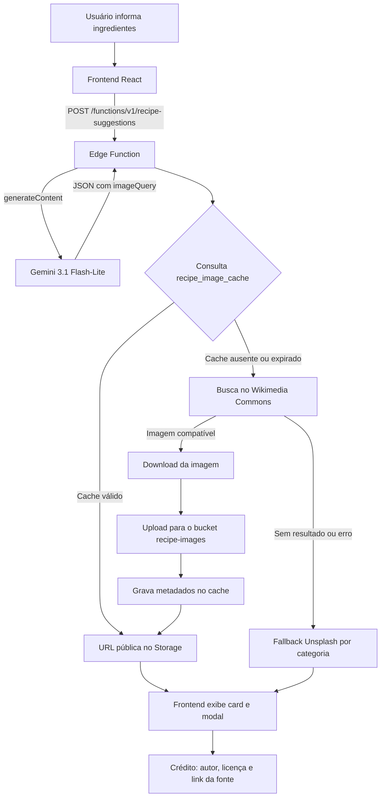

# Escopo do Incremento 2 — Receitas com Gemini econômico e fotos reais de pratos brasileiros

> **Status:** concluído e implantado em produção em 05/11/2026.
>
> **Projeto:** Smart Pantry — TCC
>
> **Ambiente:** Supabase `cojcrquveckvrdzjivmc` (`https://cojcrquveckvrdzjivmc.supabase.co`)
>
> **Documento anterior:** [`ESCOPO_INCREMENTO_1.md`](./ESCOPO_INCREMENTO_1.md)

---

## 1. Objetivo

Evoluir o motor de receitas do Smart Pantry em duas frentes:

1. Reduzir o custo de geração de receitas usando o modelo Gemini mais econômico compatível com o projeto.
2. Substituir as imagens genéricas de categoria por fotos reais de pratos brasileiros, com armazenamento próprio, cache, fallback e atribuição de licença.

O incremento mantém o escopo acadêmico: o projeto é um TCC, não um produto comercial, e o modelo pode ser trocado no futuro sem alteração do frontend.

---

## 2. Funcionalidades incluídas

- Uso do modelo `gemini-3.1-flash-lite` como padrão da Edge Function `recipe-suggestions`.
- Geração de um campo `imageQuery` por receita, com o nome popular do prato em 2 a 5 palavras.
- Busca de fotos no Wikimedia Commons usando o `imageQuery`.
- Download da imagem escolhida e upload para o bucket público `recipe-images` do Supabase Storage.
- Cache de resultados em `public.recipe_image_cache`, com validade de 30 dias.
- Filtro de licenças permitidas (CC0, domínio público, GFDL, CC BY e CC BY-SA).
- Fallback automático para a imagem genérica da categoria quando a busca falha.
- Exibição do crédito do Wikimedia Commons no card e no modal de detalhes.
- Extração da mensagem real de erro da Edge Function no frontend.
- Documentação da função e migração de banco.

## 3. Fora do escopo deste incremento

- Catálogo curado manualmente de imagens por prato.
- Geração ou edição de imagens por IA.
- Limpeza automática de imagens órfãs no Storage.
- Busca de imagens em múltiplos provedores além do Wikimedia Commons.
- Movimentações de estoque (Fase 3) e planejamento semanal (Fase 4).
- Testes automatizados de integração ponta a ponta.

---

## 4. Decisões de arquitetura

### 4.1 Modelo Gemini

| Item | Decisão |
|---|---|
| Modelo padrão | `gemini-3.1-flash-lite` |
| Configuração | Constante `DEFAULT_GEMINI_MODEL` em `supabase/functions/recipe-suggestions/index.ts` |
| Sobrescrita | Secret `GEMINI_MODEL` no Supabase |
| Endpoint | `https://generativelanguage.googleapis.com/v1beta/models/{model}:generateContent` |
| Autenticação | Header `x-goog-api-key` (a chave não aparece na URL nem nos logs) |
| Formato de saída | `responseMimeType: application/json` + `responseSchema` |
| Limite de saída | `maxOutputTokens: 8192` |
| Temperatura | `0.7` |
| Retry | Até 3 tentativas em `429`, `500`, `502`, `503` e `504`, com espera progressiva |

**Por que esse modelo?**

O `gemini-3.1-flash-lite` é a opção estável mais barata da família Flash-Lite para geração de texto estruturado. Para o volume de um TCC, a diferença de qualidade em relação aos modelos maiores é irrelevante para receitas domésticas, enquanto o custo por token é o menor da linha.

Valores de referência consultados em novembro de 2026 (sujeitos a alteração pela Google):

| Modelo | Entrada (US$/1M tokens) | Saída (US$/1M tokens) |
|---|---:|---:|
| `gemini-3.1-flash-lite` | 0,25 | 1,50 |
| `gemini-3.5-flash-lite` | 0,30 | 2,50 |
| `gemini-3.6-flash` | 0,75 | 3,75 |

> **Observação:** o `gemini-2.0-flash`, usado em versões anteriores, foi desligado pela Google em 01/06/2026. O secret `GEMINI_MODEL` permite trocar o modelo sem redeploy do código, mas a função só aceita modelos disponíveis na conta.

### 4.2 Fonte das imagens

Antes de implementar, foram avaliadas as alternativas:

| Fonte | Cobertura de pratos brasileiros | Custo | Observações |
|---|---|---|---|
| **Wikimedia Commons** | Alta para pratos típicos e regionais | Gratuito | Licenças variadas; exige atribuição e conferência |
| Pixabay | Média para comida genérica; fraca para regionais | Gratuito | Não permite hotlinking permanente; exige cache |
| Unsplash | Boa qualidade, porém genérica | Gratuito | Já era usado como fallback por categoria |
| Catálogo curado | Melhor relevância | Trabalho manual | Ideal para demonstração, mas não escala sozinho |

**Decisão:** Wikimedia Commons como fonte principal, com download para o Supabase Storage e fallback para o Unsplash por categoria. O Pixabay foi descartado como fonte principal por ter pouca cobertura de pratos regionais brasileiros e por exigir cache de 24 horas e download das imagens.

---

## 5. Arquitetura da solução



### 5.1 Contrato de resposta da Edge Function

Cada receita retornada contém, além dos campos já existentes:

```json
{
  "imageQuery": "arroz de frango",
  "image": "https://cojcrquveckvrdzjivmc.supabase.co/storage/v1/object/public/recipe-images/recipes/arroz-de-frango-10969509.jpg",
  "imageSource": "wikimedia-commons",
  "imageAuthor": "Sérgio Savaman Savarese",
  "imageLicense": "CC BY 2.0",
  "imageLicenseUrl": "https://creativecommons.org/licenses/by/2.0",
  "imageSourceUrl": "https://commons.wikimedia.org/wiki/File:Galinhada.jpg"
}
```

Quando a busca falha, `imageSource` é `"unsplash-fallback"` e os campos de crédito ficam vazios.

---

## 6. Alterações por camada

### 6.1 Edge Function `supabase/functions/recipe-suggestions/index.ts`

Principais blocos adicionados:

1. **Constantes de imagem**
   - `WIKIMEDIA_COMMONS_ENDPOINT`
   - `WIKIMEDIA_USER_AGENT` (identifica o TCC e atende à política de uso da Wikimedia)
   - `RECIPE_IMAGE_BUCKET = 'recipe-images'`
   - `IMAGE_CACHE_TTL_DAYS = 30`
   - `IMAGE_FETCH_TIMEOUT_MS = 15000`
   - `MAX_IMAGE_BYTES = 4 * 1024 * 1024`
   - `CATEGORY_IMAGE_QUERIES` (consultas de fallback por categoria)

2. **Schema do Gemini**
   - Novo campo obrigatório `imageQuery`.
   - Instrução no system prompt para usar o nome popular do prato em 2 a 5 palavras.

3. **Busca no Wikimedia Commons**
   - `action=query`, `generator=search`, `gsrnamespace=6`.
   - Busca com `filetype:bitmap` e `gsrlimit=8`.
   - `iiprop=url|mime|extmetadata` e `iiurlwidth=800`.
   - Aceita apenas `image/jpeg`, `image/png` e `image/webp`.
   - Ordena candidatos pela posição original da busca.
   - Remove HTML e entidades dos metadados de autor e licença.
   - Rejeita licenças `-NC` e `-ND`.

4. **Download e armazenamento**
   - Download com timeout de 15 segundos.
   - Valida `content-type` iniciado por `image/`.
   - Limita o arquivo a 4 MB.
   - Caminho: `recipes/<slug>-<pageId>.<ext>`.
   - Upload com `x-upsert: true` e URL pública gerada pelo Storage.

5. **Cache**
   - Leitura por `query=eq.<cacheKey>` via PostgREST.
   - Escrita com `on_conflict=query` e `Prefer: resolution=merge-duplicates`.
   - Cache expirado (mais de 30 dias) é ignorado e a imagem é buscada novamente.
   - A chave remove acentos, converte para minúsculas e normaliza espaços.

6. **Enriquecimento paralelo**
   - `enrichRecipesWithImages` usa `Promise.all` para buscar as imagens das receitas simultaneamente.
   - Qualquer erro em uma imagem não interrompe as demais; a receita afetada mantém o fallback.

7. **Mensagem de erro do frontend**
   - `app/src/services/recipe.js` passou a extrair a mensagem de `error.context` retornada pela Edge Function, exibindo o motivo real da falha em vez de um texto genérico.
   - Detalhes técnicos (`detail`) só aparecem em ambiente de desenvolvimento.

### 6.2 Banco de dados

Migração criada e aplicada: `supabase/migrations/20261105180000_recipe_images_cache.sql`.

Ela executa:

- criação da tabela `public.recipe_image_cache`;
- habilitação de Row Level Security;
- revogação de acesso para `anon` e `authenticated`;
- concessão de `select`, `insert`, `update` e `delete` para `service_role`;
- índice em `updated_at desc`;
- criação/atualização do bucket público `recipe-images`;
- política de leitura pública dos objetos do bucket.

Estrutura da tabela:

| Coluna | Tipo | Função |
|---|---|---|
| `query` | `text` (PK) | Chave normalizada da busca |
| `image_url` | `text` | URL pública da imagem no Storage |
| `storage_path` | `text` | Caminho interno do objeto |
| `source_page_url` | `text` | Página da imagem no Wikimedia Commons |
| `author` | `text` | Autor da foto |
| `license` | `text` | Licença curta (ex.: `CC BY 2.0`) |
| `license_url` | `text` | URL da licença |
| `source` | `text` | Origem (`wikimedia-commons`) |
| `created_at` | `timestamptz` | Data de criação |
| `updated_at` | `timestamptz` | Última atualização do cache |

### 6.3 Frontend

| Arquivo | Alteração |
|---|---|
| `app/src/services/recipe.js` | Normaliza e repassa `imageQuery`, `imageSource`, `imageAuthor`, `imageLicense`, `imageLicenseUrl` e `imageSourceUrl`; melhora a extração de erros da Edge Function |
| `app/src/components/FeatureCard.jsx` | Selo `Foto: Wikimedia Commons` no canto inferior esquerdo do card |
| `app/src/components/RecipeDetailModal.jsx` | Linha de crédito com autor, licença e link `ver fonte` |
| `app/src/app/App.jsx` | Comentário atualizado de Spoonacular para Gemini; nenhuma mudança de layout necessária |

O modal exibe o crédito apenas quando `imageSource === 'wikimedia-commons'` ou quando existe `imageSourceUrl`, evitando atribuição indevida nas imagens de fallback do Unsplash.

### 6.4 Documentação

- `supabase/functions/recipe-suggestions/README.md` atualizado com:
  - modelo padrão `gemini-3.1-flash-lite`;
  - exemplo de troca via `GEMINI_MODEL`;
  - seção sobre o fluxo de imagens, cache, licenças e fallback;
  - referência à migração do bucket.

---

## 7. Fluxo detalhado da imagem

1. O Gemini gera a receita e o campo `imageQuery`.
2. A função normaliza a consulta:
   - remove caracteres especiais;
   - limita a 80 caracteres;
   - usa uma consulta por categoria se o campo vier vazio ou inválido.
3. A chave de cache é calculada:
   - remove acentos;
   - converte para minúsculas;
   - normaliza espaços.
4. A função consulta `public.recipe_image_cache`.
5. Se houver registro com menos de 30 dias, usa a `image_url` existente.
6. Caso contrário, consulta o Wikimedia Commons.
7. Para cada candidato:
   - valida o MIME;
   - valida a licença;
   - escolhe a primeira imagem compatível.
8. Baixa a imagem com timeout e limite de tamanho.
9. Envia ao bucket `recipe-images`.
10. Grava/atualiza o registro no cache.
11. Retorna a URL pública e os metadados de crédito.
12. Em qualquer falha, retorna a imagem da categoria com `imageSource = "unsplash-fallback"`.

### 7.1 Regras de licença

Licenças aceitas:

- CC0;
- Public Domain;
- GFDL;
- CC BY;
- CC BY-SA.

Licenças recusadas:

- qualquer licença com `-NC` (uso não comercial);
- qualquer licença com `-ND` (sem derivações);
- licenças desconhecidas que não comecem pelos prefixos aceitos.

> **Atenção:** quando o metadado de licença vem vazio, a função atualmente aceita a imagem (`if (!license) return true`). Isso evita perder fotos antigas sem metadados, mas é um ponto de atenção para publicação e deve ser revisto antes de uma distribuição pública do projeto.

---

## 8. Cache, fallback e resiliência

### 8.1 Cache

- **Chave:** consulta normalizada.
- **TTL:** 30 dias.
- **Armazenamento:** tabela `public.recipe_image_cache`.
- **Benefício:** receitas diferentes que usam o mesmo prato reutilizam a mesma imagem, reduzindo chamadas ao Wikimedia e uploads ao Storage.
- **Expiração:** verificada na leitura; não existe job de limpeza automática.

### 8.2 Fallback

Ordem de tentativa:

1. cache válido;
2. Wikimedia Commons;
3. imagem genérica da categoria no Unsplash.

O fallback é silencioso para o usuário e registrado no console da função com a consulta, a categoria e o erro.

### 8.3 Timeouts e limites

- Busca no Commons: 15 segundos.
- Download da imagem: 15 segundos.
- Upload ao Storage: 15 segundos.
- Imagem: no máximo 4 MB.
- Formatos: JPEG, PNG e WebP.

Como o enriquecimento é paralelo, a latência total é próxima da imagem mais lenta, não da soma de todas.

---

## 9. Configuração e implantação

### 9.1 Pré-requisitos

- Projeto Supabase vinculado (`supabase link`).
- Secret `GEMINI_API_KEY` configurado.
- Login anônimo habilitado no Supabase Auth.
- Docker não é necessário para deploy remoto das funções.

### 9.2 Comandos executados

```bash
# 1. Aplicar a migração de cache e bucket
cd supabase
npx supabase db push --remote cojcrquveckvrdzjivmc --yes

# 2. Definir o modelo econômico
npx supabase secrets set GEMINI_MODEL=gemini-3.1-flash-lite \
  --project-ref cojcrquveckvrdzjivmc --yes

# 3. Publicar a função
npx supabase functions deploy recipe-suggestions \
  --project-ref cojcrquveckvrdzjivmc --yes

# 4. Validar o frontend
cd ../app
npm run lint
npm run build
```

### 9.3 Resultado da migração

```text
Applying migration 20261105180000_recipe_images_cache.sql...
{"upToDate":false,"dryRun":false,"migrations":["20261105180000_recipe_images_cache.sql"]}
```

### 9.4 Resultado do deploy

```text
Deployed Functions.
{"project_ref":"cojcrquveckvrdzjivmc","functions":["recipe-suggestions"]}
```

---

## 10. Testes e evidências

### 10.1 Requisição real

Sessão anônima criada via `POST /auth/v1/signup` e função chamada com:

```json
{
  "ingredients": ["arroz", "feijão", "frango", "tomate", "cebola"],
  "limit": 3
}
```

**Resultado:** `HTTP 200` com 3 receitas.

| Receita | Origem da imagem | Evidência |
|---|---|---|
| Frango Ensopado com Arroz e Feijão | Unsplash (fallback) | Nenhuma imagem compatível no Commons para `frango ensopado com arroz` |
| Arroz de Frango com Tomate | Wikimedia Commons | `arroz-de-frango-10969509.jpg`, autor Sérgio Savaman Savarese, CC BY 2.0 |
| Sopa de Feijão com Frango | Wikimedia Commons | `sopa-de-feijao-23125701.jpg`, autor jeffreyw, CC BY 2.0 |

### 10.2 Validação das URLs públicas

```text
https://cojcrquveckvrdzjivmc.supabase.co/storage/v1/object/public/recipe-images/recipes/arroz-de-frango-10969509.jpg
HTTP/2 200
content-type: image/jpeg
content-length: 116910

https://cojcrquveckvrdzjivmc.supabase.co/storage/v1/object/public/recipe-images/recipes/sopa-de-feijao-23125701.jpg
HTTP/2 200
content-type: image/jpeg
content-length: 117529
```

### 10.3 Validação do cache

Registros gravados na primeira chamada:

| `query` | `source` | `license` | `updated_at` |
|---|---|---|---|
| `arroz de frango` | `wikimedia-commons` | `CC BY 2.0` | 2026-11-05 21:26:20.348 |
| `sopa de feijao` | `wikimedia-commons` | `CC BY 2.0` | 2026-11-05 21:26:20.182 |

Na segunda chamada, a receita gerou `imageQuery = "sopa de feijão"`. A chave normalizada (`sopa de feijao`) encontrou o cache existente e a mesma URL foi reutilizada. O `updated_at` permaneceu inalterado, confirmando leitura de cache em vez de novo upload.

### 10.4 Frontend

```text
> eslint .
> vite build
✓ 66 modules transformed.
✓ built in 293ms
```

`npm run lint` e `npm run build` concluíram sem erros.

### 10.5 Checklist de aceite

- [x] Modelo padrão alterado para `gemini-3.1-flash-lite`.
- [x] Secret `GEMINI_MODEL` configurado no projeto remoto.
- [x] Campo `imageQuery` gerado e validado pelo schema.
- [x] Busca no Wikimedia Commons funcionando.
- [x] Download e upload para o bucket `recipe-images` funcionando.
- [x] URLs públicas retornam `200` e `image/jpeg`.
- [x] Cache de 30 dias gravado e reutilizado.
- [x] Fallback para Unsplash quando não há imagem compatível.
- [x] Crédito de autor e licença exibido no frontend.
- [x] Migração aplicada em produção.
- [x] Edge Function publicada.
- [x] Lint e build aprovados.

---

## 11. Limitações e riscos conhecidos

1. **Relevância da busca no Commons**
   - A busca textual pode retornar um prato parecido, mas não exatamente o gerado pelo Gemini.
   - Exemplo observado: a consulta `arroz de frango` retornou uma foto de galinhada, que é visualmente próxima.
   - Para a demonstração do TCC, um catálogo curado reduz esse risco.

2. **Cobertura de pratos regionais**
   - Pratos muito específicos podem não ter imagem no Commons e cair no fallback genérico.
   - Isso é esperado e não interrompe a experiência.

3. **Licença ausente**
   - Imagens sem metadado de licença são aceitas para não perder resultados.
   - Antes de uso público amplo, o critério deve ser revisto.

4. **Limpeza de Storage**
   - Imagens antigas ou substituídas não são removidas automaticamente.
   - Não há job de expiração de cache nem de objetos órfãos.

5. **Latência da primeira chamada**
   - Cada receita pode aguardar até 15 segundos por busca/download.
   - Como as buscas são paralelas, o pior caso é próximo de 15 segundos, não de 15 × número de receitas.

6. **Cache-Control do Storage**
   - O upload envia `cache-control: public, max-age=31536000, immutable`, mas a resposta pública observada veio com `cache-control: private, no-cache`.
   - Isso não impede o funcionamento, mas pode afetar cache de CDN/navegador.

7. **Testes manuais**
   - Não há testes automatizados para busca, licença, cache ou fallback.
   - A validação foi feita por chamadas reais e consultas ao banco.

8. **Dependência do Wikimedia Commons**
   - A disponibilidade e a relevância dependem da API pública da Wikimedia.
   - Indisponibilidades temporárias caem no fallback, mas não há uma segunda fonte de imagem real configurada.

---

## 12. Próximos passos

1. **Catálogo curado de imagens**
   - Selecionar de 20 a 40 fotos de pratos brasileiros no Wikimedia Commons.
   - Mapear por prato/categoria e usar como prioridade antes da busca dinâmica.

2. **Limpeza e manutenção**
   - Criar rotina para remover registros de cache expirados e objetos órfãos do bucket.
   - Monitorar tamanho do bucket e quantidade de imagens.

3. **Testes automatizados**
   - Testar normalização de `imageQuery`, chave de cache, filtro de licença e fallback.
   - Adicionar um teste de fumaça da Edge Function com sessão anônima.

4. **Observabilidade**
   - Registrar métricas de acerto/fallback por categoria.
   - Acompanhar erros 429/5xx do Gemini e do Wikimedia.

5. **Alinhamento da documentação**
   - Manter `docs/plano_implementaca_v2.md`, este escopo e o README da função sincronizados a cada novo incremento.

6. **Evolução das fases seguintes**
   - Fase 3: movimentações de estoque e baixa por consumo.
   - Fase 4: planejamento semanal de refeições.

---

## 13. Arquivos impactados

| Arquivo | Tipo de alteração |
|---|---|
| `supabase/functions/recipe-suggestions/index.ts` | Modelo, schema, busca Commons, Storage, cache e fallback |
| `supabase/functions/recipe-suggestions/README.md` | Documentação do modelo e do fluxo de imagens |
| `supabase/migrations/20261105180000_recipe_images_cache.sql` | Tabela de cache, bucket e política pública |
| `app/src/services/recipe.js` | Normalização dos metadados e erros da função |
| `app/src/components/FeatureCard.jsx` | Selo de crédito no card |
| `app/src/components/RecipeDetailModal.jsx` | Crédito completo no modal |
| `app/src/app/App.jsx` | Comentário atualizado de Spoonacular para Gemini |
| `docs/ESCOPO_INCREMENTO_2.md` | Este documento |

---

## 14. Referências

- [Gemini API — Pricing](https://ai.google.dev/gemini-api/docs/pricing)
- [Gemini API — Structured Output](https://ai.google.dev/gemini-api/docs/structured-output)
- [Wikimedia Commons API](https://commons.wikimedia.org/w/api.php)
- [Wikimedia Commons — Licensing](https://commons.wikimedia.org/wiki/Commons:Licensing)
- [Supabase Storage](https://supabase.com/docs/guides/storage)
- [Supabase Edge Functions](https://supabase.com/docs/guides/functions)
- [Supabase Row Level Security](https://supabase.com/docs/guides/database/postgres/row-level-security)
