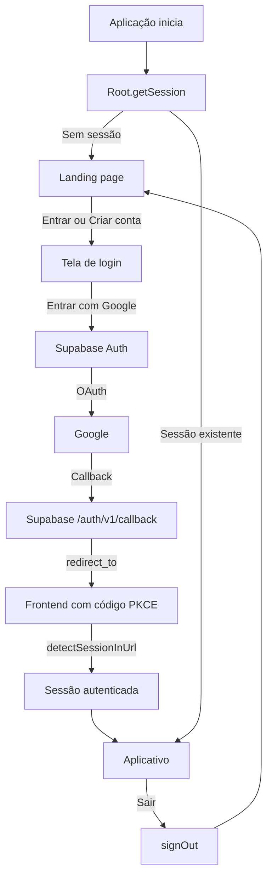
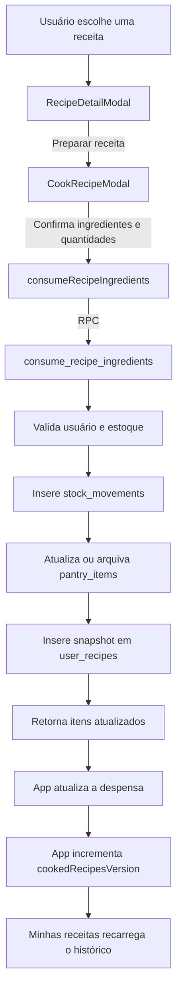

# Escopo do Incremento 3 — Histórico de receitas, autenticação com Google e deploy público

> **Status:** concluído e implantado em produção em 08/11/2026.
>
> **Projeto:** Smart Pantry — TCC
>
> **Ambiente Supabase:** `cojcrquveckvrdzjivmc` (`https://cojcrquveckvrdzjivmc.supabase.co`)
>
> **Frontend em produção:** `https://smart-pantry-coral.vercel.app`
>
> **Documento anterior:** [`ESCOPO_INCREMENTO_2.md`](./ESCOPO_INCREMENTO_2.md)

---

## 1. Objetivo

Este incremento consolida três frentes que transformaram o Smart Pantry de um MVP com sessão anônima em uma aplicação publicada, com conta própria e histórico persistente:

1. **Histórico de receitas por usuário:** registrar cada preparo confirmado, mantendo ingredientes, passos e data de execução.
2. **Autenticação com Google:** substituir a sessão anônima automática por uma landing page pública, login OAuth e acesso protegido ao aplicativo.
3. **Publicação em produção:** disponibilizar o frontend em uma URL HTTPS pública, configurar Supabase e Google Cloud e validar o fluxo de ponta a ponta.

Como os dados existentes no Supabase eram apenas de teste, foi adotada uma transição direta: nenhum usuário anônimo é migrado e nenhuma sessão anônima é criada pelo frontend.

---

## 2. Funcionalidades incluídas

### 2.1 Histórico de receitas

- Tabela `public.user_recipes`, com um registro por execução de receita.
- Vínculo obrigatório com `auth.users` por meio de `user_id`.
- Snapshot completo da receita: título, imagem, categoria, tempo, porções, ingredientes usados, ingredientes faltantes, passos e metadados de imagem.
- Registro automático no mesmo commit transacional do consumo dos ingredientes.
- Página **Minhas receitas** com:
  - indicadores de preparos, receitas diferentes e última execução;
  - inventário agrupado por receita, com contagem de preparos;
  - busca por nome ou categoria;
  - linha do tempo dos preparos individuais;
  - abertura do modal de detalhes a partir do snapshot salvo.
- Navegação lateral e mobile com o item **Minhas receitas** no lugar do antigo atalho **Receitas**.
- Atualização imediata do histórico após confirmar o preparo de uma receita.

### 2.2 Autenticação com Google

- Landing page pública como tela inicial.
- Tela de login e de criação de conta com o botão **Entrar com Google**.
- OAuth do Google por meio do Supabase Auth.
- Sessão persistida no navegador, com renovação automática e detecção do retorno do OAuth.
- Gate de autenticação: a despensa, as receitas e o histórico só são carregados quando existe sessão.
- Perfil no cabeçalho e no menu lateral com avatar, nome e e-mail do Google.
- Menu de conta com logout.
- Logout retorna à landing page e descarta o estado da conta anterior.
- Tratamento de erros do OAuth com mensagem amigável.
- Remoção completa de `signInAnonymously` do frontend.
- Login anônimo desabilitado no projeto Supabase remoto.

### 2.3 Publicação e configuração

- Deploy do frontend na Vercel em `https://smart-pantry-coral.vercel.app`.
- Configuração de build para a subpasta `app/`.
- Configuração do provider Google no Supabase.
- Configuração da Site URL e das Redirect URLs do Supabase.
- Configuração da origem JavaScript e do redirect URI no Google Cloud.
- Documentação das variáveis de ambiente e do processo de deploy.

---

## 3. Fora do escopo deste incremento

- Migração dos dados de usuários anônimos existentes.
- Vínculo de identidade (`linkIdentity`) entre sessão anônima e conta Google.
- Fusão de dados entre duas contas.
- Login com e-mail/senha ou outros provedores.
- Recuperação de senha.
- Exclusão ou exportação de conta pelo usuário.
- Tela de histórico de movimentações de estoque.
- Planejamento semanal persistente (Fase 4).
- Testes automatizados de integração e ponta a ponta em CI.
- Funcionamento offline ou instalação como PWA.
- Domínio próprio na Vercel.

---

## 4. Decisões de arquitetura

### 4.1 Histórico como snapshot por execução

| Item | Decisão |
|---|---|
| Granularidade | Uma linha por preparo, não uma linha por receita |
| Conteúdo | Snapshot completo da receita no momento do preparo |
| Agrupamento | Feito na interface, por `recipe_id` ou título |
| Data | `cooked_at`, com índice por usuário e data |
| Exclusão | `on delete cascade` a partir de `auth.users` |
| RLS | Cada usuário lê, cria, altera e exclui apenas as próprias linhas |

Guardar uma linha por execução preserva a data de cada uso e permite reconstruir a linha do tempo. O inventário agrupado é uma visão derivada, não uma segunda tabela.

O snapshot evita depender do Gemini para reabrir uma receita antiga. Se o modelo, o prompt ou a fonte de imagens mudarem, o histórico continua exibindo exatamente o que foi preparado.

### 4.2 Consumo e histórico na mesma transação

A função `consume_recipe_ingredients` passou a receber o snapshot da receita (`p_recipe`) e executa, em uma única transação:

1. validação do usuário e dos itens;
2. bloqueio dos itens com `FOR UPDATE`;
3. inserção em `stock_movements`;
4. atualização ou arquivamento em `pantry_items`;
5. inserção em `user_recipes`;
6. retorno dos itens atualizados.

Se qualquer etapa falhar, nada é persistido. Não existe receita contabilizada sem baixa no estoque nem consumo sem entrada no histórico.

### 4.3 Autenticação com Google e PKCE

| Item | Decisão |
|---|---|
| Provedor | Google OAuth via Supabase Auth |
| Fluxo | PKCE |
| Persistência | `persistSession: true` |
| Renovação | `autoRefreshToken: true` |
| Retorno do OAuth | `detectSessionInUrl: true` |
| Destino | `window.location.origin` |
| Sessão anônima | Removida do frontend e desabilitada no Supabase |
| Gate | `Root.jsx` resolve a sessão antes de montar o aplicativo |
| Isolamento de estado | `<App key={session.user.id} />` |
| Carregamento | `App.jsx` carregado sob demanda com `React.lazy` |

O destino do OAuth é calculado em tempo de execução. Assim, o mesmo build funciona em localhost, preview e produção, desde que cada URL esteja cadastrada no Google Cloud e no Supabase.

### 4.4 Controller de autenticação separado do aplicativo

A lógica de autenticação ficou concentrada em `Root.jsx`, e não dentro do grande `App.jsx`. O controller:

- resolve a sessão inicial com `getSession()`;
- escuta login, logout e renovação com `onAuthStateChange`;
- controla a transição landing → login → aplicativo;
- lê erros do OAuth na query string ou no hash;
- limpa os parâmetros de autenticação da URL;
- executa o logout e devolve o usuário à landing page.

O `App.jsx` recebe apenas `user` e `onSignOut`.

### 4.5 Serviços exigem sessão autenticada

`getCurrentSession()` consulta a sessão real e lança um erro claro quando não há usuário:

```text
Entre com sua conta Google para continuar.
```

Nenhum serviço cria sessão, e nenhuma chamada à despensa, às receitas ou ao histórico acontece antes do gate de autenticação.

### 4.6 Deploy na Vercel

| Item | Decisão |
|---|---|
| Plataforma | Vercel |
| Diretório raiz | `app` |
| Framework | Vite |
| Build | `npm run build` |
| Saída | `dist` |
| Variáveis | `VITE_SUPABASE_URL` e `VITE_SUPABASE_PUBLISHABLE_KEY` |
| Configuração | `app/vercel.json` |
| URL de produção | `https://smart-pantry-coral.vercel.app` |

O deploy foi conectado ao repositório GitHub. Cada push na branch `main` gera uma nova publicação.

---

## 5. Arquitetura da solução

### 5.1 Fluxo de autenticação



### 5.2 Fluxo de preparo e histórico



---

## 6. Alterações por camada

### 6.1 Banco de dados

#### Migração `20261108160000_user_recipes.sql`

Cria a tabela `public.user_recipes`:

| Coluna | Tipo | Função |
|---|---|---|
| `id` | `uuid` (PK) | Identificador do preparo |
| `user_id` | `uuid` | Dono da receita, com FK para `auth.users` |
| `recipe_id` | `text` | Identificador da receita no formato do frontend |
| `title` | `text` | Título no momento do preparo |
| `image` | `text` | URL da imagem |
| `category` | `text` | Categoria da receita |
| `ready_in_minutes` | `integer` | Tempo de preparo |
| `servings` | `integer` | Porções |
| `used_ingredients` | `jsonb` | Ingredientes disponíveis usados |
| `missed_ingredients` | `jsonb` | Ingredientes que faltavam |
| `steps` | `jsonb` | Modo de preparo |
| `image_query` | `text` | Consulta usada para a imagem |
| `image_source` | `text` | Origem da imagem |
| `image_author` | `text` | Autor da imagem |
| `image_license` | `text` | Licença |
| `image_license_url` | `text` | URL da licença |
| `image_source_url` | `text` | Página original da imagem |
| `cooked_at` | `timestamptz` | Data do preparo |
| `created_at` | `timestamptz` | Data de criação do registro |

Índices:

- `user_recipes_user_cooked_idx (user_id, cooked_at desc)`;
- `user_recipes_user_recipe_idx (user_id, recipe_id)`.

Políticas RLS:

- `select`: `(select auth.uid()) = user_id`;
- `insert`: `with check ((select auth.uid()) = user_id)`;
- `update`: `using` e `with check` por `user_id`;
- `delete`: `using ((select auth.uid()) = user_id)`.

Permissões:

- `revoke all` de `anon`;
- `grant select, insert, update, delete` para `authenticated`.

#### Função `consume_recipe_ingredients`

A assinatura passou de:

```sql
consume_recipe_ingredients(text, text, jsonb)
```

para:

```sql
consume_recipe_ingredients(
  p_recipe_id text,
  p_recipe_title text,
  p_items jsonb,
  p_recipe jsonb
)
```

A função usa `security invoker`, `search_path = ''` e valida `auth.uid()`. O snapshot é normalizado e inserido em `user_recipes` antes do retorno.

### 6.2 Serviços do frontend

| Arquivo | Alteração |
|---|---|
| `app/src/services/movements.js` | Envia o snapshot completo da receita e chama a nova assinatura da RPC |
| `app/src/services/userRecipes.js` | Lista o histórico do usuário e normaliza os snapshots para o contrato dos cards |
| `app/src/services/pantry.js` | Passa a exigir sessão autenticada |
| `app/src/lib/auth.js` | Centraliza `getSession`, `onAuthStateChange`, `signInWithGoogle`, `signOut` e dados do perfil |
| `app/src/lib/session.js` | Retorna a sessão autenticada ou lança erro; não cria mais sessão anônima |
| `app/src/lib/supabase.js` | Configura persistência, renovação automática, detecção de sessão na URL e PKCE |

### 6.3 Componentes e telas

| Arquivo | Alteração |
|---|---|
| `app/src/app/Root.jsx` | Novo controller de autenticação e navegação entre landing, login e aplicativo |
| `app/src/app/MyRecipesPage.jsx` | Novo inventário de receitas preparadas, com busca, estatísticas e linha do tempo |
| `app/src/app/App.jsx` | Recebe `user` e `onSignOut`; navega para Minhas receitas; integra o consumo com histórico; carrega identidade na sidebar |
| `app/src/components/LandingPage.jsx` | Nova landing page pública |
| `app/src/components/LoginScreen.jsx` | Nova tela de login/cadastro com Google |
| `app/src/components/UserAvatar.jsx` | Novo avatar com fallback para a inicial do nome |
| `app/src/components/AppHeader.jsx` | Menu de conta com avatar, nome, e-mail e logout |
| `app/src/main.jsx` | Passa a renderizar `Root` em vez de `App` |
| `app/src/components/CookRecipeModal.jsx` | Modal de confirmação do consumo, integrado ao histórico |
| `app/src/lib/format.js` | Formatação de quantidades |
| `app/src/lib/ingredientMatch.js` | Correspondência entre ingredientes da receita e itens da despensa |

### 6.4 Configuração e infraestrutura

| Arquivo | Alteração |
|---|---|
| `app/vercel.json` | Build do Vite, saída em `dist` e fallback de SPA |
| `supabase/config.toml` | URLs locais e de produção, Google habilitado, anônimo desabilitado |
| `supabase/.env.example` | Exemplo das credenciais Google para o Supabase local |
| `.gitignore` | Inclusão de `.vercel/` |
| `README.md` | Documentação de autenticação, configuração do Google e deploy na Vercel |
| `docs/ESTADO_ATUAL_DO_PROJETO.md` | Atualização do estado do projeto |
| `docs/ESCOPO_INCREMENTO_3.md` | Este documento |

### 6.5 Reorganização de documentação

O arquivo `docs/plano_implementaca_v2.md` foi renomeado para `docs/plano_implementacao_v2.md`, corrigindo o nome. O conteúdo foi preservado.

---

## 7. Fluxos detalhados

### 7.1 Registro de uma receita preparada

1. O usuário abre uma receita sugerida.
2. O modal de detalhes exibe ingredientes, tempo, porções e passos.
3. Ao escolher **Preparar receita**, o `CookRecipeModal` mostra quais itens da despensa serão consumidos.
4. O usuário ajusta as quantidades e confirma.
5. O frontend chama `consumeRecipeIngredients` com:
   - receita completa;
   - `recipeId`;
   - `recipeTitle`;
   - itens e quantidades.
6. A RPC valida a sessão, o estoque e as quantidades.
7. A RPC grava a movimentação de consumo, atualiza o saldo, arquiva itens zerados e insere o snapshot.
8. O frontend atualiza a despensa local com os itens retornados.
9. O contador `cookedRecipesVersion` é incrementado.
10. A mensagem de sucesso informa que a receita foi registrada em **Minhas receitas**.
11. Ao abrir a aba, o histórico é carregado da tabela `user_recipes`.

### 7.2 Inicialização da aplicação

1. `main.jsx` renderiza `Root`.
2. `Root` chama `getSession()`.
3. Sem sessão: mostra a landing page.
4. Com sessão: monta `App` com `key={user.id}`.
5. O `App` só então chama `listPantryItems()` e os demais serviços.
6. `onAuthStateChange` mantém a interface sincronizada com login, logout e renovação.

### 7.3 Login com Google

1. O usuário clica em **Entrar** ou **Criar conta**.
2. A tela de login chama `signInWithGoogle`.
3. O Supabase redireciona para o Google.
4. O Google devolve o usuário ao callback do Supabase.
5. O Supabase devolve o usuário para o frontend com o código PKCE.
6. O cliente Supabase detecta a sessão na URL e troca o código.
7. `onAuthStateChange` recebe a sessão.
8. `Root` limpa os parâmetros da URL e monta o aplicativo.
9. O cabeçalho e a sidebar exibem nome, e-mail e avatar.

### 7.4 Logout

1. O usuário abre o menu de conta e escolhe **Sair da conta**.
2. `signOut()` encerra a sessão no Supabase.
3. `Root` remove a sessão do estado e volta para a landing page.
4. O `App` é desmontado com todo o estado da despensa, receitas e modais.

---

## 8. Segurança e RLS

- Todas as tabelas de dados usam `auth.uid()` nas políticas.
- `user_recipes` tem RLS habilitado e permissões apenas para `authenticated`.
- `anon` não possui acesso à tabela de histórico.
- A RPC de consumo valida o usuário e usa `security invoker`.
- O frontend utiliza apenas a chave publicável do Supabase.
- O Client Secret do Google fica somente no Supabase.
- Nenhuma chave privada é enviada ao navegador.
- O login anônimo foi desabilitado no projeto remoto.
- O estado do aplicativo é recriado por usuário com `key={session.user.id}`.

### 8.1 Verificação do isolamento

O desenho de segurança depende de três camadas:

1. **Gate de autenticação:** sem sessão, o app nem é montado.
2. **RLS:** mesmo que o cliente tente consultar outro `user_id`, o banco bloqueia.
3. **Estado do React:** a troca de conta descarta o estado da conta anterior.

---

## 9. Configuração e implantação

### 9.1 Migração aplicada

```bash
npx supabase db push --remote cojcrquveckvrdzjivmc --yes
```

Resultado:

```text
Applying migration 20261108160000_user_recipes.sql...
{"upToDate":false,"dryRun":false,"migrations":["20261108160000_user_recipes.sql"]}
```

### 9.2 Supabase Auth

Configuração do ambiente de produção:

- **Providers → Google:** habilitado com Client ID e Client Secret.
- **URL Configuration → Site URL:** `https://smart-pantry-coral.vercel.app`.
- **URL Configuration → Redirect URLs:** `https://smart-pantry-coral.vercel.app`.
- **Settings → Allow anonymous sign-ins:** desabilitado.

O provider Google e a desabilitação do login anônimo foram confirmados pelo endpoint público `/auth/v1/settings`:

```text
google habilitado: True
anonimo habilitado: False
```

### 9.3 Google Cloud

Configuração necessária no OAuth Client ID:

- **Authorized JavaScript origins:** `https://smart-pantry-coral.vercel.app`.
- **Authorized redirect URIs:** `https://cojcrquveckvrdzjivmc.supabase.co/auth/v1/callback`.

O redirect URI continua apontando para o Supabase. A URL da Vercel é o destino final do frontend, não o redirect do Google.

### 9.4 Vercel

Configuração do projeto:

| Item | Valor |
|---|---|
| Repositório | `bongiovanii/Smart-Pantry` |
| Root Directory | `app` |
| Framework | Vite |
| Build Command | `npm run build` |
| Output Directory | `dist` |
| Variáveis | `VITE_SUPABASE_URL`, `VITE_SUPABASE_PUBLISHABLE_KEY` |

URL publicada:

```text
https://smart-pantry-coral.vercel.app
```

O deploy é acionado automaticamente por push na branch `main`.

### 9.5 Ambiente local

```bash
cd app
npm install
npm run dev
```

Para o Supabase local, criar `supabase/.env` com:

```text
GOOGLE_CLIENT_ID=...
GOOGLE_CLIENT_SECRET=...
```

O frontend continua usando apenas:

```text
VITE_SUPABASE_URL
VITE_SUPABASE_PUBLISHABLE_KEY
```

### 9.6 Qualidade

```bash
cd app
npm run lint
npm run build
```

---

## 10. Testes e evidências

### 10.1 Teste de ponta a ponta do consumo e histórico

Executado no projeto remoto com um item temporário, antes da desabilitação do login anônimo:

```text
Item arquivado e saldo zerado: true
Receita no histórico do usuário: true
Movimentação de consumo registrada: true
TESTE DE PONTA A PONTA APROVADO
```

O teste confirmou:

- consumo total arquiva o item e zera o saldo;
- a receita é gravada em `user_recipes` com vínculo ao usuário;
- a movimentação `consumption` é registrada em `stock_movements`;
- os dados temporários foram removidos ao final.

### 10.2 Build e lint

```text
> eslint .
> vite build
✓ built in 301ms
```

Sem erros. O build final gerou:

```text
dist/assets/App-BAcqswsz.js   58.64 kB
dist/assets/index-CeDgo43u.js 450.99 kB
```

O `App` foi separado em um chunk próprio para manter a landing page mais leve.

### 10.3 Teste do deploy

- `GET https://smart-pantry-coral.vercel.app/` retornou `HTTP 200`.
- A landing page foi renderizada com o título e os botões esperados.
- A tela de login foi renderizada ao clicar em **Entrar**.
- A tela de cadastro foi renderizada ao clicar em **Criar conta**.
- O botão **Entrar com Google** redirecionou para `accounts.google.com` com:
  - `redirect_uri=https://cojcrquveckvrdzjivmc.supabase.co/auth/v1/callback`;
  - `redirect_to=https://smart-pantry-coral.vercel.app`.
- O teste foi repetido em viewport desktop e mobile.
- Nenhum erro de console ou de página foi registrado.

### 10.4 Checklist de aceite

- [x] Landing page pública implementada.
- [x] Tela de login e cadastro com Google implementada.
- [x] Gate de autenticação impede chamadas sem sessão.
- [x] Sessão persiste após recarregar a página.
- [x] Logout retorna à landing page.
- [x] Perfil com avatar, nome e e-mail exibido.
- [x] Login anônimo removido do frontend.
- [x] Login anônimo desabilitado no Supabase.
- [x] Google OAuth habilitado no Supabase.
- [x] Histórico `user_recipes` criado com RLS.
- [x] Consumo e histórico gravados na mesma transação.
- [x] Página Minhas receitas com inventário, busca e linha do tempo.
- [x] Migração aplicada no projeto remoto.
- [x] Deploy na Vercel publicado.
- [x] ESLint e build aprovados.
- [x] Fluxo de login validado em navegador real.

---

## 11. Limitações e riscos conhecidos

1. **Dependência do Google**
   - Não há login alternativo. Uma indisponibilidade do Google ou do provider impede o acesso.

2. **URL de produção vinculada à Vercel**
   - Se o projeto for renomeado ou transferido, a URL muda.
   - Nesse caso, atualizar Google Cloud, Supabase e documentação.

3. **Preview deployments**
   - URLs de preview da Vercel não estão automaticamente autorizadas no Supabase.
   - Para usá-las, é necessário cadastrar o padrão de URL nas Redirect URLs.

4. **Usuários anônimos antigos**
   - O frontend não os utiliza mais, mas registros criados antes da migração ainda podem existir em `auth.users`.
   - A limpeza é opcional e não afeta o funcionamento atual.

5. **Dados anônimos descartados**
   - Por decisão de escopo, não houve migração de despensa, movimentações ou receitas de sessões anônimas.
   - Os dados existentes eram de teste.

6. **Testes automatizados**
   - A validação foi manual e com automação pontual de navegador.
   - Não há suíte de testes de integração em CI.

7. **Histórico de movimentações**
   - `stock_movements` recebe os consumos, mas ainda não possui tela própria.

8. **Planejamento semanal**
   - Continua demonstrativo, sem persistência.

9. **Sessão expirada**
   - O cliente renova tokens automaticamente, mas não há uma tela dedicada para sessão expirada ou revogada.

10. **Consentimento Google**
    - Enquanto o app estiver em modo de teste no Google Cloud, apenas usuários de teste conseguem entrar.
    - Para uso amplo, a tela de consentimento precisa ser publicada.

---

## 12. Próximos passos

1. **Domínio próprio (opcional)**
   - Configurar um domínio na Vercel e atualizar Google Cloud e Supabase.

2. **Testes automatizados**
   - Cobrir o gate de autenticação, o fluxo de consumo e o histórico.
   - Adicionar verificação de build em CI.

3. **Histórico de movimentações**
   - Criar tela para entradas, consumos, ajustes e descartes.

4. **Fase 4 — planejamento semanal**
   - Transformar o planejamento demonstrativo em funcionalidade persistente.

5. **Gestão de conta**
   - Exportação e exclusão de dados.
   - Configurações de perfil.

6. **Observabilidade**
   - Registrar erros de OAuth e falhas de consumo.
   - Acompanhar uso e latência da Edge Function.

7. **Limpeza de contas anônimas antigas**
   - Avaliar rotina administrativa para remover usuários sem dados e sem atividade.

8. **Revisão de segurança**
   - Validar RLS com duas contas Google reais.
   - Revisar permissões e políticas antes da entrega final do TCC.

---

## 13. Arquivos impactados

| Arquivo | Tipo de alteração |
|---|---|
| `app/src/app/Root.jsx` | Novo controller de autenticação |
| `app/src/app/MyRecipesPage.jsx` | Novo inventário de receitas preparadas |
| `app/src/app/App.jsx` | Navegação, identidade, logout e integração do histórico |
| `app/src/components/LandingPage.jsx` | Nova landing page |
| `app/src/components/LoginScreen.jsx` | Nova tela de login Google |
| `app/src/components/UserAvatar.jsx` | Novo avatar de usuário |
| `app/src/components/AppHeader.jsx` | Menu de conta e logout |
| `app/src/components/CookRecipeModal.jsx` | Confirmação de consumo |
| `app/src/lib/auth.js` | Funções de autenticação |
| `app/src/lib/session.js` | Sessão autenticada obrigatória |
| `app/src/lib/supabase.js` | Persistência, PKCE e renovação |
| `app/src/lib/format.js` | Formatação de quantidades |
| `app/src/lib/ingredientMatch.js` | Correspondência de ingredientes |
| `app/src/services/movements.js` | Consumo com snapshot da receita |
| `app/src/services/userRecipes.js` | Consulta ao histórico |
| `app/src/services/pantry.js` | Exigência de sessão |
| `app/src/main.jsx` | Renderização de `Root` |
| `app/vercel.json` | Configuração de deploy |
| `supabase/config.toml` | Google, URLs e anônimo desabilitado |
| `supabase/.env.example` | Credenciais locais do Google |
| `supabase/migrations/20261108120000_stock_movements_consumption.sql` | Movimentações de consumo |
| `supabase/migrations/20261108160000_user_recipes.sql` | Histórico de receitas e nova RPC |
| `docs/ESTADO_ATUAL_DO_PROJETO.md` | Atualização do estado atual |
| `docs/plano_implementacao_v2.md` | Renomeação do plano |
| `docs/ESCOPO_INCREMENTO_3.md` | Este documento |
| `README.md` | Autenticação e deploy |
| `.gitignore` | Inclusão de `.vercel/` |

---

## 14. Referências

- [Supabase Auth](https://supabase.com/docs/guides/auth)
- [Supabase Auth — Google](https://supabase.com/docs/guides/auth/social-login/auth-google)
- [Supabase Auth — PKCE flow](https://supabase.com/docs/guides/auth/sessions/pkce-flow)
- [Supabase Row Level Security](https://supabase.com/docs/guides/database/postgres/row-level-security)
- [React — Lazy loading](https://react.dev/reference/react/lazy)
- [Vercel — Vite](https://vercel.com/docs/frameworks/vite)
- [Google Cloud — OAuth 2.0](https://developers.google.com/identity/protocols/oauth2)
- [Google Cloud — Authorized redirect URIs](https://support.google.com/cloud/answer/13463073)
