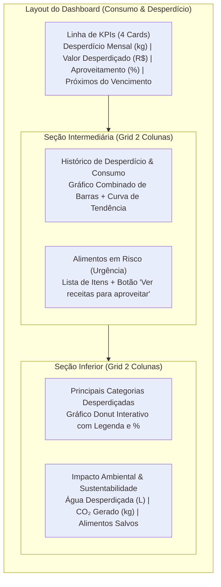
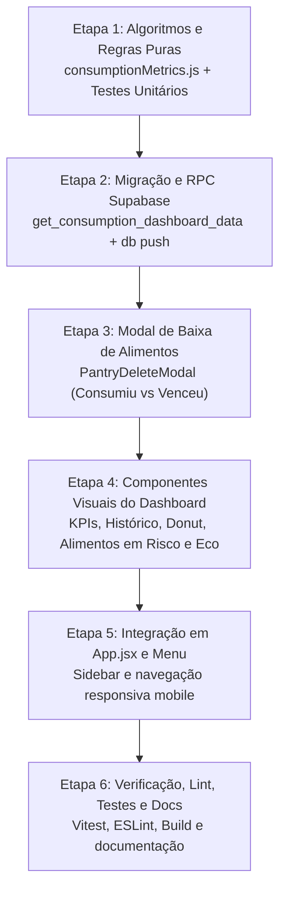

# Plano de Implementação: Aba de Consumo & Desperdício (Dashboard Analítico)

**Projeto:** Smart Pantry  
**Data:** 12 de novembro de 2026  
**Status:** Proposta de Implementação (Aguardando feedback/aprovação)  
**Inspiração:** Mockup oficial do Smart Pantry e referências visuais de dashboards modernos (`media_1794500831226_bb8ee5d0.jpg`, `media_1794500875491_7692f731.jpg`, `media_1794500885815_89470392.jpg`).

---

## 1. Visão Geral e Alinhamento Visual

A nova aba **Consumo & Desperdício** fecha o ciclo do Smart Pantry: ela transforma os dados operacionais da despensa (entradas, validades, cozimento de receitas e baixas de estoque) em **inteligência prática e conscientização financeira e ambiental**.

### 1.1 Análise das Referências Fornecidas



- **Foto 1 (Mockup Base Smart Pantry):** Define a identidade central da tela:
  - Menu lateral: novo item **"Consumo & Desperdício"** com ícone `analytics` / `monitoring`.
  - 4 KPIs principais com badges de tendência e ícones coloridos com fundo suave.
  - Gráfico de barras semanais de desperdício com linha de tendência sobreposta.
  - Painel de **Alimentos em Risco** com call-to-action imediato: botão de ação rápida *"Ver receitas para aproveitar"*, que filtra receitas na hora para evitar que a comida estrague.
  - Gráfico Donut de categorias e painel de **Impacto Ambiental** (Litros de água e emissão de CO₂).
- **Fotos 2 e 3 (Refinamento Estético e Interatividade):**
  - Cartões com cantos arredondados (`rounded-2xl` / `surface-card`), sombras sutis e bordas limpas.
  - Gráficos fluidos com gradiente suave (do verde floresta `#154212` / `#2d5a27` para transparente).
  - Tooltips interativos ao passar o mouse ou tocar em cada ponto/barra.
  - Seletor de período rápido (Ex: *Últimos 30 dias*, *Últimas 8 semanas*, *Últimos 90 dias*).

---

## 2. Algoritmos e Lógica de Mapeamento de Consumo

O grande desafio do mapeamento de consumo é que alimentos entram na despensa em diferentes grandezas físicas (`un`, `kg`, `g`, `l`, `ml`, `pacote`, `caixa`, `lata`) e nem sempre o usuário registra notas fiscais ou preços. Desenvolvemos 5 algoritmos complementares para resolver isso com rigor:

### 2.1 Algoritmo 1: Conversão Unificada de Massa ($kg_{eq}$) e Volume ($L_{eq}$)

Para somar itens heterogêneos em uma métrica unificada (ex: "12,4 kg desperdiçados"), cada movimentação é convertida para quilogramas equivalentes ($kg_{eq}$) através de fatores específicos por unidade e categoria:

| Unidade | Regra de Conversão para $kg_{eq}$ | Justificativa / Referência |
|---|---|---|
| `kg` | $Q \times 1.0$ | Identidade direta |
| `g` | $Q / 1000$ | Divisão decimal |
| `l` | $Q \times 1.0$ (líquidos gerais) | Densidade da água / leite ($\approx 1.0\text{ kg/L}$) |
| `ml` | $Q / 1000$ | Divisão decimal |
| `un` (hortifrúti) | $Q \times 0.15\text{ kg}$ | Peso médio de frutas e legumes (tomate, maçã, cebola) |
| `un` (panificação) | $Q \times 0.05\text{ kg}$ | Peso médio de pão francês / fatia ($\approx 50\text{g}$) |
| `un` (ovos / laticínios) | $Q \times 0.06\text{ kg}$ | Peso de um ovo padrão médio ($\approx 60\text{g}$) |
| `un` (outros) | $Q \times 0.20\text{ kg}$ | Estimativa padrão ponderada de unidade |
| `pacote` | $Q \times 0.50\text{ kg}$ | Padrão nacional de embalagens secas (500g) |
| `caixa` | $Q \times 0.40\text{ kg}$ | Padrão médio de caixas de alimentos |
| `lata` | $Q \times 0.35\text{ kg}$ | Padrão de conservas e latas comerciais (350g) |

### 2.2 Algoritmo 2: Estimativa Financeira de Custo Desperdiçado (R$)

O Smart Pantry prioriza a agilidade no cadastro (o usuário cadastra em 3 segundos sem precisar digitar preço). Para exibir o valor financeiro desperdiçado de forma realista, o sistema aplica uma tabela de precificação média ponderada da cesta de consumo brasileira (baseada em médias históricas CEAGESP/IBGE e Procon):

| Categoria | Preço Estimado de Referência (R$/kg) |
|---|---|
| **Carnes e Aves** | R\$ 38,00 / kg |
| **Laticínios e Derivados** | R\$ 18,50 / kg |
| **Panificação e Massas** | R\$ 14,00 / kg |
| **Outros / Processados** | R\$ 12,00 / kg |
| **Hortifrúti (Frutas e Vegetais)** | R\$ 8,50 / kg |
| **Grãos, Cereais e Leguminosas** | R\$ 7,50 / kg |
| **Bebidas** | R\$ 6,00 / L |

$$\text{Valor Desperdiçado (R\$)} = \sum_{i \in \text{Descartes}} \left(\text{Quantidade em } kg_{eq}(i) \times \text{Preço Ref}(\text{categoria}_i)\right)$$

> [!NOTE]
> Caso no futuro seja adicionado um campo opcional de preço no cadastro do ingrediente, o algoritmo usará o preço real cadastrado como prioridade 1 e a tabela de referência como fallback.

### 2.3 Algoritmo 3: Taxa de Eficiência e Aproveitamento de Alimentos (%)

Mede a eficiência do usuário na gestão de suprimentos:

$$\text{Aproveitamento (\%)} = \frac{\text{Total Consumido } (kg_{eq})}{\text{Total Consumido } (kg_{eq}) + \text{Total Desperdiçado } (kg_{eq})} \times 100\%$$

- **Casos de borda:**
  - Se $\text{Consumo} + \text{Desperdício} = 0$: retorna `100%` com mensagem motivadora de boas-vindas ("Sua despensa está em dia! Registre o preparo de receitas para calibrar seu índice.").
  - Compara o mês corrente contra o mês anterior:
    $$\Delta\% = \text{Aproveitamento}_{\text{atual}} - \text{Aproveitamento}_{\text{anterior}}$$

### 2.4 Algoritmo 4: Classificação de Desperdício no Fluxo da Aplicação

Como o sistema distingue o que foi consumido do que foi jogado fora?
1. **Consumo confirmado (`consumption`):**
   - Quando o usuário clica em *"Cozinhar Receita"* ou registra consumo de ingredientes na receita $\to$ `stock_movements.movement_type = 'consumption'`.
2. **Descarte / Desperdício explícito (`waste`):**
   - Ao clicar no botão de excluir (lixeira) de um ingrediente na despensa, o sistema hoje apenas remove da lista ativa.
   - **Melhoria proposta:** um modal rápido e intuitivo *"O que aconteceu com este item?"*:
     - 🍽️ **"Foi consumido"** $\to$ debita com `movement_type = 'consumption'`.
     - 🗑️ **"Venceu / Estragou"** $\to$ debita com `movement_type = 'waste'`, status `'descartado'` e motivo.
     - ✏️ **"Cadastrei por engano"** $\to$ apenas arquiva (`archived_at`), sem distorcer o histórico de consumo nem de desperdício.
3. **Desperdício implícito (Alimentos vencidos abandonados):**
   - Se um item estiver vencido há mais de 10 dias e for arquivado sem consumo, o sistema o classifica automaticamente como descarte por validade.

### 2.5 Algoritmo 5: Estimativa de Pegada Ecológica (Impacto Ambiental)

Baseado em fatores da **FAO** (*Food and Agriculture Organization of the United Nations*) e do **Water Footprint Network**:

1. **Pegada Hídrica (Água em Litros por kg desperdiçado):**
   $$\text{Água Total (L)} = \sum_{i} \left(kg_{eq}(i) \times \text{Fator Hídrico}(\text{categoria}_i)\right)$$
   - *Hortifrúti:* 350 L/kg
   - *Grãos e Pães:* 1.400 L/kg
   - *Laticínios:* 2.400 L/kg
   - *Carnes:* 10.500 L/kg
   - *Média Ponderada Global:* 1.250 L/kg

2. **Emissão de Gases do Efeito Estufa (CO₂ equivalente):**
   - O descarte de resíduos orgânicos em aterros produz metano ($CH_4$), um gás com potencial de aquecimento global 28x maior que o $CO_2$.
   - Fator médio de conversão: **$2,1\text{ kg } CO_2e$ por cada $1\text{ kg}$ de alimento desperdiçado**.
   $$\text{Emissão Total } (kg\ CO_2e) = \text{Massa Total Desperdiçada } (kg_{eq}) \times 2,1$$

---

## 3. Arquitetura e Modelagem no Supabase

### 3.1 Nenhuma quebra no schema atual
Nossa tabela `stock_movements` já possui nativamente o `movement_type check (movement_type in ('entry', 'consumption', 'waste', 'adjustment', 'reversal'))`. 

### 3.2 Nova RPC de Alto Desempenho: `get_consumption_dashboard_data`

Criaremos uma RPC PostgreSQL transacional `get_consumption_dashboard_data(p_period text default '8_weeks')` que processa todas as agregações de uma só vez no servidor, retornando um payload enxuto em JSON:

```sql
create or replace function public.get_consumption_dashboard_data(
  p_period text default '8_weeks'
)
returns jsonb
language plpgsql
security invoker
set search_path = public
as $$
-- Calcula:
-- 1. kpis: waste_kg, waste_cost, efficiency_pct, at_risk_count, diff_vs_last_month
-- 2. waste_history: array ordenado por semanas [{ week_label, waste_kg, consumption_kg, trend_value }]
-- 3. top_categories: array [{ category, label, percentage, kg, color }]
-- 4. at_risk_foods: array de itens com vencimento <= 3 dias [{ id, name, category, days_left, urgency }]
-- 5. eco_impact: { water_liters, co2_kg, food_saved_kg }
$$;
```

---

## 4. Componentes e Estrutura Frontend

### 4.1 Novos Componentes (`app/src/components/dashboard/`)

```text
app/src/
  ├── app/
  │   ├── ConsumptionDashboardPage.jsx     # Página completa da aba de consumo
  │   └── App.jsx                          # Registro no menu lateral e navegação mobile
  ├── components/
  │   ├── dashboard/
  │   │   ├── DashboardKpiCard.jsx         # Card dos 4 indicadores do topo
  │   │   ├── WasteHistoryChart.jsx        # Gráfico SVG responsivo de barras + linha de tendência
  │   │   ├── AtRiskFoodsCard.jsx          # Lista de alimentos em risco com CTA de receitas
  │   │   ├── CategoryDonutChart.jsx       # Gráfico Donut de categorias em SVG nativo
  │   │   ├── EcoImpactCard.jsx            # Métricas de água (L) e CO2 (kg)
  │   │   └── PantryDeleteModal.jsx        # Modal enriquecido: consumiu vs estragou vs cancelou
  ├── lib/
  │   ├── consumptionMetrics.js            # Algoritmos puros de conversão de kg, custos e eco
  │   └── __tests__/
  │       └── consumptionMetrics.test.js   # Bateria completa de testes unitários
  └── services/
      └── consumptionDashboard.js          # Chamada RPC com caching e fallbacks
```

### 4.2 Gráficos SVG Nativos (Sem Dependências Pesadas)
Para manter o bundle do Vite super leve (como atualmente, que constrói em ~350ms):
- Gráfico de barras e curva de Bézier em SVG nativo interativo.
- Gráfico Donut em SVG nativo com arcos calculados por trigonometria simples.
- Animações suaves de hover, tooltips flutuantes com valores exatos e acessibilidade para leitores de tela (`aria-label`).
- Utiliza os mesmos tokens de cores já presentes em `index.css`:
  - Primária: `#154212`
  - Container primário: `#2d5a27`
  - Container secundário: `#d9e6da`
  - Superfícies: `#f8faf8` e `#ffffff`
  - Alertas de risco: tons quentes `#b91c1c` e `#ea580c`

---

## 5. Plano de Execução Passo a Passo



1. **Etapa 1 — Algoritmos Puros e Testes Unitários:**
   - Criar `app/src/lib/consumptionMetrics.js` com conversões de unidades, precificação por categoria, fórmula de aproveitamento e fatores de pegada ecológica.
   - Criar testes com Vitest cobrindo todos os cenários e casos de borda.
2. **Etapa 2 — Banco de Dados e RPC:**
   - Criar migração SQL com a RPC `get_consumption_dashboard_data`.
   - Aplicar no banco de dados remoto com `npx supabase db push`.
3. **Etapa 3 — Rastreamento Realista de Desperdício:**
   - Atualizar a exclusão de itens na despensa para perguntar o motivo (Consumido / Descartado por validade / Erro de cadastro).
4. **Etapa 4 — Desenvolvimento da Interface do Dashboard:**
   - Construir os cards de KPI, o gráfico combinado semanal, o donut de categorias, o painel de impacto ambiental e a lista de alimentos em risco.
   - Fazer o botão *"Ver receitas para aproveitar"* abrir o modal de receitas já focado no ingrediente selecionado.
5. **Etapa 5 — Integração na Navegação:**
   - Adicionar o item **"Consumo & Desperdício"** no menu lateral do desktop e na navegação mobile.
6. **Etapa 6 — Verificação e Publicação:**
   - Testes manuais no navegador.
   - Execução de `npm test`, `npm run lint` e `npm run build`.
   - Atualização de `docs/ESTADO_ATUAL_DO_PROJETO.md`.

---

## 6. Próxima Decisão do Usuário

O plano acima contempla todos os detalhes visuais das 3 referências e os algoritmos matemáticos necessários.
