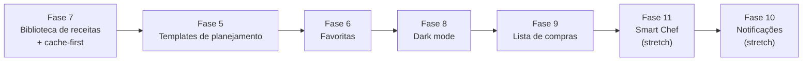

# Plano de Implementação v3 — Smart Pantry

**Data:** 12 de novembro de 2026

**Versão:** 1.3

**Status:** em execução; Fases 7, 5 e 10 concluídas em 12/11/2026; fases 6, 8, 9 e 11 planejadas; Fase 6 (Favoritas) é a próxima.

**Documentos relacionados:**
- [`DECISOES_DE_PROJETO.md`](./DECISOES_DE_PROJETO.md) — perguntas e respostas que orientam este plano.
- [`plano_testes.md`](./plano_testes.md) — estratégia e casos de teste.
- [`ESTADO_ATUAL_DO_PROJETO.md`](./ESTADO_ATUAL_DO_PROJETO.md) — estado oficial do projeto.
- [`plano_implementacao_v2.md`](./plano_implementacao_v2.md) — fases 1 a 4, concluídas.

---

## 1. Objetivo

Este plano detalha as fases 5 a 11 do Smart Pantry, com foco em:

- transformar as receitas geradas pela IA em uma **biblioteca persistida e reutilizável**;
- permitir **templates de planejamento semanal** com ciclo de 4 semanas e histórico;
- adicionar **favoritas**, **descobrir mais receitas**, **dark mode** e **lista de compras**;
- preparar a base de **notificações de vencimento** e do **chatbot Smart Chef**;
- reduzir o consumo de tokens do Gemini com uma estratégia **cache-first** baseada na despensa e no histórico do usuário.

A ordem de execução segue as dependências técnicas aprovadas:



> [!IMPORTANT]
> As fases **10 e 11 são stretch**. O núcleo funcional do TCC são as fases **5, 6, 7, 8 e 9**. As partes apenas cosméticas de qualquer fase também são stretch.

---

## 2. Princípios adotados

1. **Um incremento por fase.** Cada fase tem migração, serviço, interface, documentação, testes e deploy próprios.
2. **Cache antes da IA.** Toda geração de receita consulta primeiro a biblioteca do usuário no Supabase.
3. **Snapshot como fonte de verdade.** Planejamento, favoritas e histórico guardam o snapshot completo da receita para não depender de uma nova chamada ao Gemini.
4. **RLS em todas as tabelas.** Nenhum dado de receita, planejamento, lista de compras, notificação ou chat pode ser lido por outro usuário.
5. **Mínimo de dependências.** A única dependência nova crítica é o **Vitest** (desenvolvimento). O restante usa React, Tailwind, Supabase e APIs nativas do navegador.
6. **Mobile-first e acessibilidade.** Novas telas seguem o padrão atual, com navegação inferior no mobile, foco visível e textos alternativos.
7. **Degradação segura.** Se a IA falhar, a biblioteca e o planejamento continuam funcionando. Se o cache falhar, a geração tradicional assume.
8. **Documentação incremental.** Cada fase atualiza `ESTADO_ATUAL_DO_PROJETO.md` e cria `ESCOPO_INCREMENTO_N.md`.

---

## 3. Arquitetura alvo

```text
Usuário
   |
   v
React + Vite (mobile-first, dark mode)
   |
   +--> Serviços Supabase (pantry, recipes, meal plans, shopping, notifications, chat)
   |        |
   |        +--> PostgreSQL + RLS
   |        +--> RPCs transacionais
   |
   `--> Edge Functions (Deno/TypeScript)
            |
            +--> recipe-suggestions (cache-first + Gemini)
            `--> chef-chat (contexto + Gemini + limite diário)
```

### 3.1 Camadas

| Camada | Responsabilidade |
|---|---|
| `app/src/app` | Composição das páginas, navegação e estado global. |
| `app/src/components` | Componentes visuais reutilizáveis e modais. |
| `app/src/services` | Contratos com o Supabase e as Edge Functions. |
| `app/src/lib` | Funções puras: normalização, ciclo semanal, tema, snapshots. |
| `supabase/migrations` | Tabelas, índices, RLS e RPCs. |
| `supabase/functions` | Integração segura com o Gemini e regras de cache/limite. |

### 3.2 Decisões transversais

- **Normalização de nomes** (receitas e ingredientes) feita em uma função pura compartilhada no frontend e replicada em `supabase/functions/_shared/` para a Edge Function.
- **Datas de semana** sempre calculadas com a segunda-feira como início (`date_trunc('week', ...)` no PostgreSQL e função equivalente no cliente).
- **Fuso horário** padrão `America/Sao_Paulo` para janelas de notificação e limites diários; o banco armazena `timestamptz`.
- **Paginação** padrão de 20 itens nas listas de receitas e histórico.
- **Erros** sempre exibidos em português, com mensagem específica e ação de tentar novamente.

---

## 4. Modelo de dados consolidado

| Tabela | Fase | Finalidade |
|---|---|---|
| `recipes` | 7 | Biblioteca de receitas por usuário, com snapshot, ingredientes normalizados e favorito. |
| `recipe_generations` | 7 | Auditoria e limite diário de gerações por IA. |
| `meal_plan_cycles` | 5 | Ciclo ativo de 4 semanas por usuário. |
| `meal_plan_templates` | 5 | Até 4 templates por usuário, um por semana do ciclo. |
| `meal_plan_template_items` | 5 | Slots dia × refeição de cada template. |
| `meal_plan_weeks` | 5 | Metadados e histórico das semanas aplicadas. |
| `meal_plans` | 5 | Evolução: passa a ter `week_start` e histórico por semana. |
| `shopping_list_items` | 9 | Lista de compras persistida. |
| `user_settings` | 10 | Preferências: tema e notificações. |
| `notifications` | 10 | Central de notificações in-app. |
| `chat_messages` | 11 | Conversa persistida com o Smart Chef. |
| `chat_usage` | 11 | Controle diário de mensagens. |

### 4.1 RPCs previstas

| RPC | Fase | Papel |
|---|---|---|
| `find_recipes_for_pantry(p_ingredients text[], p_limit int)` | 7 | Busca cache-first por sobreposição de ingredientes. |
| `upsert_generated_recipes(p_recipes jsonb)` | 7 | Persiste receitas geradas com dedupe por título. |
| `get_or_create_active_cycle()` | 5 | Garante o ciclo ativo de 4 semanas. |
| `sync_meal_plan_week()` | 5 | Avança a semana, registra histórico e aplica template recorrente. |
| `apply_meal_plan_template(p_template_id uuid)` | 5 | Copia o template para a semana atual em transação. |
| `save_current_week_as_template(p_name text, p_description text)` | 5 | Cria/atualiza template a partir da semana atual. |
| `duplicate_meal_plan_template(p_template_id uuid)` | 5 | Duplica template e itens. |
| `record_pantry_entry(p_item_id uuid, p_quantity numeric, p_reason text)` | 9 | Registra entrada e atualiza o saldo. |
| `create_pantry_item_with_entry(...)` | 9 | Cria item já com movimentação de entrada. |
| `get_shopping_suggestions(p_days int)` | 9 | Agrega consumo/entradas e retorna sugestões. |
| `generate_expiration_notifications()` | 10 | Gera avisos in-app de vencimento. |
| `consume_chat_message()` | 11 | Incrementa e valida o limite de 7 mensagens/dia. |

---

## 5. Fase 7 — Biblioteca de receitas e geração cache-first

### 5.1 Objetivo

Persistir todas as receitas geradas pela IA e consultar a biblioteca do usuário antes de chamar o Gemini, economizando tokens e permitindo que as fases 5, 6, 9, 10 e 11 reutilizem as receitas.

### 5.2 Migração `2026xxxx_recipes_library.sql`

#### Tabela `recipes`

```sql
create table public.recipes (
  id uuid primary key default gen_random_uuid(),
  user_id uuid not null references auth.users(id) on delete cascade,
  title text not null check (char_length(trim(title)) between 1 and 200),
  title_normalized text not null,
  category text not null default 'outros',
  image text,
  ready_in_minutes integer not null default 0 check (ready_in_minutes >= 0),
  servings integer not null default 0 check (servings >= 0),
  calories_per_serving integer not null default 0 check (calories_per_serving >= 0),
  used_ingredients jsonb not null default '[]'::jsonb,
  missed_ingredients jsonb not null default '[]'::jsonb,
  steps jsonb not null default '[]'::jsonb,
  ingredient_names text[] not null default '{}',
  source text not null default 'ai' check (source in ('ai', 'cooked', 'manual')),
  is_favorite boolean not null default false,
  favorited_at timestamptz,
  created_at timestamptz not null default now(),
  updated_at timestamptz not null default now(),
  constraint recipes_user_title_unique unique (user_id, title_normalized)
);

create index recipes_ingredients_gin_idx
on public.recipes using gin (ingredient_names);

create index recipes_user_created_idx
on public.recipes (user_id, created_at desc);

create index recipes_user_favorite_idx
on public.recipes (user_id, is_favorite)
where is_favorite;
```

- `title_normalized` e `ingredient_names` são preenchidos pela aplicação/Edge Function com normalização sem acentos, minúsculas e sem pontuação.
- `used_ingredients` e `missed_ingredients` guardam os objetos completos (nome, quantidade, unidade), preservando o snapshot.
- `steps` guarda o array de passos.
- RLS padrão por `user_id`, com `revoke all from anon` e `grant select, insert, update, delete to authenticated`.

#### Tabela `recipe_generations`

```sql
create table public.recipe_generations (
  id uuid primary key default gen_random_uuid(),
  user_id uuid not null references auth.users(id) on delete cascade,
  generated_at timestamptz not null default now(),
  requested_count integer not null default 0,
  generated_count integer not null default 0,
  cache_hits integer not null default 0,
  source text not null default 'ai' check (source in ('ai', 'cache', 'mixed'))
);

create index recipe_generations_user_day_idx
on public.recipe_generations (user_id, generated_at desc);
```

#### RPC `find_recipes_for_pantry`

```sql
create or replace function public.find_recipes_for_pantry(
  p_ingredients text[],
  p_limit integer default 6
)
returns setof public.recipes
language sql
stable
security invoker
set search_path = public
as $$
  select r.*
  from public.recipes r
  where r.user_id = (select auth.uid())
    and r.ingredient_names && p_ingredients
  order by
    cardinality(
      array(
        select unnest(r.ingredient_names)
        intersect
        select unnest(p_ingredients)
      )
    ) desc,
    r.created_at desc
  limit greatest(1, least(p_limit, 24));
$$;
```

- A Edge Function complementa o resultado com receitas que tenham pelo menos **2 ingredientes em comum** ou **60% dos ingredientes da receita** disponíveis.
- Se o cache retornar a quantidade pedida, o Gemini **não é chamado**.
- Se retornar parcialmente, o Gemini gera apenas a diferença.

#### RPC `upsert_generated_recipes`

Recebe o array JSON normalizado, faz `insert ... on conflict (user_id, title_normalized) do update` e devolve as linhas persistidas com IDs canônicos. O `is_favorite` existente **não é sobrescrito**.

### 5.3 Edge Function `recipe-suggestions`

Alterações:

1. Ler o header `Authorization` e criar um cliente Supabase com a sessão do usuário.
2. Validar o usuário com `auth.getUser()`; retornar `401` se não houver sessão.
3. Normalizar os ingredientes recebidos.
4. Chamar `find_recipes_for_pantry` antes do Gemini.
5. Se o cache cobrir o limite, responder com `source: 'cache'`.
6. Se não cobrir:
   - verificar o limite de **10 gerações/dia** em `recipe_generations`;
   - chamar o Gemini apenas para a diferença;
   - persistir as novas receitas via `upsert_generated_recipes`;
   - registrar a geração com `generated_count`, `cache_hits` e `source`;
   - responder com `source: 'mixed'` ou `'ai'`.
7. Manter o fallback de modelos e o enriquecimento de imagens existentes.
8. Aceitar o modo `mode: 'library'` para o modal “Descobrir mais receitas” (não gera; apenas lista a biblioteca com paginação).

Contrato de resposta:

```json
{
  "recipes": [],
  "source": "cache | mixed | ai",
  "cacheHits": 4,
  "generated": 2,
  "remainingGenerationsToday": 8
}
```

### 5.4 Serviços e funções puras

- `app/src/lib/normalizeRecipe.js`
  - `normalizeText(value)`: minúsculas, remove acentos, pontuação e espaços duplicados.
  - `normalizeIngredientName(value)`: normalização + remoção conservadora de plural.
  - `buildIngredientNames(recipe)`: une `usedIngredients` e `missedIngredients`.
- `app/src/services/recipeLibrary.js`
  - `listRecipes({ search, page, pageSize })`
  - `listFavoriteRecipes()`
  - `toggleFavoriteRecipe(recipe)`
  - `saveRecipeSnapshot(recipe, source)`
  - `countGenerationsToday()`
- `app/src/services/recipe.js`
  - passa a enviar o JWT automaticamente (o SDK já envia a sessão);
  - normaliza a resposta com `source`, `cacheHits` e `remainingGenerationsToday`;
  - mantém o contrato atual para não quebrar a tela da despensa.

### 5.5 Interface

- **Modal “Descobrir mais receitas”** (`DiscoverRecipesModal.jsx`):
  - abre pelo botão existente na seção de receitas sugeridas;
  - grade com busca, categoria e paginação de 20;
  - badge “Da sua biblioteca” ou “Gerada agora”;
  - botão **Gerar mais receitas** com contador de gerações restantes;
  - estado vazio com orientação para cadastrar ingredientes.
- **Card de receita** e **modal de detalhes** passam a exibir o botão de favorito (preparação da fase 6).
- **Planejamento** passa a usar a biblioteca como fonte principal no seletor de receitas.

### 5.6 Critérios de pronto

- [ ] Receitas geradas são persistidas e sobrevivem ao recarregamento.
- [ ] A mesma receita não é duplicada por título normalizado.
- [ ] Uma segunda busca com a mesma despensa não chama o Gemini quando a biblioteca já cobre o limite.
- [ ] O limite de 10 gerações/dia é respeitado e exibido na interface.
- [ ] RLS impede acesso a receitas de outro usuário.
- [ ] A tela atual da despensa continua funcionando sem regressão.
- [ ] ESLint, build e testes unitários passam.

### 5.7 Riscos

| Risco | Mitigação |
|---|---|
| Normalização agressiva unir receitas diferentes | Dedupe apenas por título normalizado; ingredientes são usados para ranking, não para exclusão. |
| Cache retornar receitas ruins | Exigir sobreposição mínima e ordenar por quantidade de ingredientes em comum. |
| Edge Function sem JWT quebrar o fluxo atual | O SDK do Supabase já envia a sessão; validar e retornar erro claro. |
| Custo de armazenamento | Snapshot em JSONB é pequeno; paginação e limite de 24 por consulta. |

---

## 6. Fase 5 — Aba de planejamento com templates

### 6.1 Objetivo

Criar uma aba de planejamento com até 4 templates semanais (um por semana do ciclo de 4 semanas), permitindo aplicar, editar, renomear, duplicar e excluir, além de manter histórico das semanas.

### 6.2 Modelo de dados

#### Evolução de `meal_plans`

```sql
alter table public.meal_plans
add column if not exists week_start date not null
default (date_trunc('week', now()))::date;

alter table public.meal_plans
drop constraint if exists meal_plans_user_slot_unique;

alter table public.meal_plans
add constraint meal_plans_user_week_slot_unique
unique (user_id, week_start, day_of_week, meal_type);
```

- O planejamento deixa de ser apenas recorrente: cada linha pertence a uma semana real.
- A interface continua exibindo a semana atual; o histórico consulta semanas anteriores.
- A migração preenche as linhas existentes com a segunda-feira da semana corrente.

#### Tabelas

```sql
create table public.meal_plan_cycles (
  id uuid primary key default gen_random_uuid(),
  user_id uuid not null references auth.users(id) on delete cascade,
  started_on date not null,
  status text not null default 'active' check (status in ('active', 'closed')),
  created_at timestamptz not null default now(),
  updated_at timestamptz not null default now()
);

create unique index meal_plan_cycles_one_active_idx
on public.meal_plan_cycles (user_id)
where status = 'active';

create table public.meal_plan_templates (
  id uuid primary key default gen_random_uuid(),
  user_id uuid not null references auth.users(id) on delete cascade,
  name text not null check (char_length(trim(name)) between 1 and 80),
  description text,
  week_index smallint not null check (week_index between 1 and 4),
  created_at timestamptz not null default now(),
  updated_at timestamptz not null default now(),
  constraint meal_plan_templates_user_week_unique unique (user_id, week_index)
);

create table public.meal_plan_template_items (
  id uuid primary key default gen_random_uuid(),
  template_id uuid not null references public.meal_plan_templates(id) on delete cascade,
  user_id uuid not null references auth.users(id) on delete cascade,
  day_of_week text not null check (day_of_week in ('SEG','TER','QUA','QUI','SEX','SAB','DOM')),
  meal_type text not null check (meal_type in ('Café da manhã','Almoço','Lanche','Jantar')),
  recipe_id uuid references public.recipes(id) on delete set null,
  recipe_snapshot jsonb not null default '{}'::jsonb,
  created_at timestamptz not null default now(),
  updated_at timestamptz not null default now(),
  constraint meal_plan_template_items_slot_unique unique (template_id, day_of_week, meal_type)
);

create table public.meal_plan_weeks (
  id uuid primary key default gen_random_uuid(),
  user_id uuid not null references auth.users(id) on delete cascade,
  cycle_id uuid not null references public.meal_plan_cycles(id) on delete cascade,
  week_start date not null,
  week_index smallint not null check (week_index between 1 and 4),
  applied_template_id uuid references public.meal_plan_templates(id) on delete set null,
  created_at timestamptz not null default now(),
  constraint meal_plan_weeks_user_start_unique unique (user_id, week_start)
);
```

- Limite de **4 templates por usuário** garantido por `unique (user_id, week_index)`.
- `meal_plan_template_items` tem RLS por `user_id` e valida que o template pertence ao mesmo usuário na camada de serviço/RPC.
- `meal_plan_weeks` registra a semana e o template aplicado; o snapshot completo continua em `meal_plans`.

#### RPCs

- `get_or_create_active_cycle()`: retorna o ciclo ativo; se não existir, cria com a segunda-feira corrente.
- `sync_meal_plan_week()`:
  1. garante o ciclo ativo;
  2. calcula `week_index = floor((segunda_atual - started_on) / 7) % 4 + 1`;
  3. garante a linha em `meal_plan_weeks`;
  4. se a semana atual ainda não tem refeições e existe template para o `week_index`, copia o template (recorrência);
  5. não apaga semanas anteriores.
- `apply_meal_plan_template(p_template_id)`: apaga as refeições da semana atual e copia os itens do template em transação.
- `save_current_week_as_template(p_name, p_description)`: cria ou atualiza o template do `week_index` atual com as refeições da semana.
- `duplicate_meal_plan_template(p_template_id)`: duplica o template e seus itens, desde que haja `week_index` livre.

### 6.3 Serviços

- `app/src/services/mealPlanTemplates.js`
  - `listTemplates()`
  - `createTemplate({ name, description, weekIndex })`
  - `updateTemplate(id, { name, description })`
  - `deleteTemplate(id)`
  - `duplicateTemplate(id)`
  - `saveCurrentWeekAsTemplate({ name, description })`
  - `applyTemplate(id)`
  - `listTemplateItems(templateId)`
  - `upsertTemplateItem(templateId, { dayOfWeek, mealType, recipe })`
  - `removeTemplateItem(itemId)`
- `app/src/services/mealPlan.js`
  - `listWeeklyPlan(weekStart = currentMonday())`
  - `listPlanHistory({ page, pageSize })`
  - `syncCurrentWeek()`
- `app/src/lib/week.js`
  - `getMonday(date)`
  - `formatWeekRange(monday)`
  - `getCycleWeekIndex(startedOn, monday)`
  - `addWeeks(date, amount)`

### 6.4 Interface

- Nova página `app/src/app/PlanningPage.jsx`, acessível pela aba **Planejamento** já existente no menu.
- Seções:
  1. **Semana atual** — cabeçalho com “Semana X de 4”, intervalo de datas e botão **Salvar como template**; grade `WeekPlanner` completa.
  2. **Meus templates** — cards com nome, descrição, semana do ciclo, quantidade de refeições e ações:
     - **Aplicar** (com confirmação de substituição);
     - **Editar** (abre a grade em modo template);
     - **Renomear**;
     - **Duplicar**;
     - **Excluir** (com confirmação).
  3. **Histórico** — lista de semanas anteriores com intervalo, template aplicado e quantidade de refeições; ação **Ver** abre um modal somente leitura; ação **Restaurar** (stretch) copia para a semana atual.
- `TemplateEditorModal.jsx` reutiliza a grade do `WeekPlanner` com `mode="template"`.
- O seletor de receitas do planejamento usa a biblioteca da fase 7, com busca e filtro por categoria.
- A página **Minha despensa** continua exibindo a semana atual completa, agora alimentada por `listWeeklyPlan()` com `week_start`.

### 6.5 Critérios de pronto

- [x] Usuário consegue criar até 4 templates, um por semana do ciclo.
- [x] Nome é obrigatório; descrição é opcional.
- [x] Aplicar um template substitui a semana atual após confirmação.
- [x] Editar a semana não altera o template.
- [x] Renomear, duplicar e excluir funcionam com confirmação.
- [x] O ciclo avança a cada semana e repete os templates a cada 4 semanas.
- [x] O histórico preserva semanas anteriores.
- [x] RLS impede acesso a templates de outro usuário.
- [x] ESLint, build e testes passam.

### 6.6 Riscos

| Risco | Mitigação |
|---|---|
| Fuso horário mudar a virada da semana | Cálculo sempre pela segunda-feira local e `date` no banco. |
| Aplicação automática surpreender o usuário | Só aplica o template recorrente se a semana atual estiver vazia. |
| Limite de 4 templates bloquear o usuário | Mensagem clara e ação de editar/excluir o template existente. |
| Histórico crescer indefinidamente | Paginação de 20 semanas e política futura de retenção. |

---

## 7. Fase 6 — Favoritas

### 7.1 Objetivo

Permitir favoritar receitas em qualquer lugar e reuni-las em uma seção **Favoritas** dentro de **Minhas receitas**.

### 7.2 Modelo e serviços

- Aproveita `recipes.is_favorite` e `recipes.favorited_at` da fase 7.
- `toggleFavoriteRecipe(recipe)`:
  - se a receita ainda não estiver na biblioteca, faz `upsert` do snapshot com `source: 'cooked'`;
  - alterna `is_favorite` e atualiza `favorited_at`.
- `listFavoriteRecipes({ search, sort })` ordena por `favorited_at desc` ou título.
- O snapshot completo permanece na linha, atendendo à decisão de “snapshot + ID canônico”.

### 7.3 Interface

- Componente `FavoriteButton.jsx` com coração preenchido/vazio, `aria-pressed` e tooltip.
- Presente em:
  - card de sugestão (`FeatureCard`);
  - modal de detalhes (`RecipeDetailModal`);
  - cards e histórico de `MyRecipesPage`;
  - cards do `WeekPlanner`.
- `MyRecipesPage` ganha abas internas:
  - **Inventário** (atual);
  - **Favoritas** (nova);
  - **Histórico** (atual).
- A aba Favoritas tem busca, ordenação (recentes / A-Z), remoção do favorito e abertura de detalhes.
- Estado vazio orienta a favoritar receitas na despensa ou na biblioteca.

### 7.4 Critérios de pronto

- [ ] Favoritar e desfavoritar funciona em todos os pontos previstos.
- [ ] A favorita continua abrindo mesmo que a receita não esteja nas sugestões atuais.
- [ ] A aba Favoritas lista, busca, ordena e remove favoritas.
- [ ] RLS impede acessar favoritas de outro usuário.
- [ ] Testes e build passam.

---

## 8. Fase 8 — Dark mode e aba Configurações

### 8.1 Objetivo

Adicionar a aba **Configurações** com um seletor de tema (Claro, Escuro, Sistema), persistido em `localStorage` e aplicado em toda a aplicação, incluindo landing e login.

### 8.2 Implementação

- `app/src/lib/theme.js`
  - chave `smart-pantry-theme`;
  - valores `light`, `dark`, `system`;
  - `resolveTheme(preference)`;
  - `applyTheme(theme)`: alterna `.dark` em `<html>`, define `color-scheme` e atualiza `<meta name="theme-color">`.
- `app/src/app/ThemeProvider.jsx`
  - contexto com `preference`, `resolvedTheme`, `setPreference`;
  - listener de `matchMedia('(prefers-color-scheme: dark)')` quando a preferência é `system`;
  - aplicação antes da primeira pintura para evitar “flash” (script inline no `index.html` ou inicialização síncrona).
- Tailwind v4:
  - adicionar `@custom-variant dark (&:where(.dark, .dark *));` em `app/src/styles/index.css`;
  - criar tokens semânticos para superfícies, texto, bordas e estados;
  - substituir `bg-white`, `bg-red-50`, `text-red-800` e afins por tokens que tenham variante escura;
  - `surface-card` passa a usar `var(--color-card)` em vez de `#fff`.
- `app/src/app/SettingsPage.jsx`
  - seção **Aparência** com três opções em radio/cards;
  - seção **Notificações** com o toggle da fase 10 (criado depois, com placeholder até lá);
  - texto explicando que a preferência fica salva neste navegador.
- Aplicar o tema também em `LandingPage` e `LoginPage`.

### 8.3 Critérios de pronto

- [ ] Tema Claro, Escuro e Sistema funcionam e persistem após recarregar.
- [ ] “Sistema” acompanha a mudança do sistema operacional em tempo real.
- [ ] Não há “flash” de tema claro ao carregar.
- [ ] Landing, login, despensa, receitas, planejamento e modais ficam legíveis no escuro.
- [ ] Contraste atende ao mínimo de acessibilidade (WCAG AA para texto).
- [ ] Testes e build passam.

---

## 9. Fase 9 — Minha lista de compras

### 9.1 Objetivo

Criar a aba **Minha lista de compras** com sugestões baseadas no histórico de consumo e de entradas, itens faltantes do planejamento e itens manuais, além do fluxo de **Repor/Entrada** na despensa.

### 9.2 Fluxo de entrada (pré-requisito)

#### RPC `record_pantry_entry`

```sql
create or replace function public.record_pantry_entry(
  p_item_id uuid,
  p_quantity numeric,
  p_reason text default 'Reposição'
)
returns public.pantry_items
language plpgsql
security invoker
set search_path = public
as $$
declare
  v_item public.pantry_items;
begin
  if p_quantity is null or p_quantity <= 0 then
    raise exception 'A quantidade de entrada deve ser maior que zero.';
  end if;

  select *
  into v_item
  from public.pantry_items
  where id = p_item_id
    and user_id = (select auth.uid())
    and archived_at is null
  for update;

  if not found then
    raise exception 'Item da despensa não encontrado.';
  end if;

  insert into public.stock_movements (
    user_id, pantry_item_id, movement_type, quantity, reason
  ) values (
    (select auth.uid()), p_item_id, 'entry', p_quantity, p_reason
  );

  update public.pantry_items
  set quantity = quantity + p_quantity,
      status = 'em_estoque',
      archived_at = null,
      updated_at = now()
  where id = p_item_id
  returning * into v_item;

  return v_item;
end;
$$;
```

#### RPC `create_pantry_item_with_entry`

- Insere o item com a quantidade inicial e grava uma movimentação `entry` com motivo “Cadastro inicial”.
- Usada pelo formulário de novo ingrediente para que todo item nasça com histórico.

#### Interface

- Botão **Repor** em cada card da despensa.
- `PantryEntryModal.jsx` com quantidade, unidade fixa e motivo opcional.
- O saldo é atualizado localmente com a linha retornada pela RPC.

### 9.3 Tabela `shopping_list_items`

```sql
create table public.shopping_list_items (
  id uuid primary key default gen_random_uuid(),
  user_id uuid not null references auth.users(id) on delete cascade,
  name text not null check (char_length(trim(name)) between 1 and 120),
  name_normalized text not null,
  category text not null default 'outros',
  unit text not null,
  quantity numeric(12, 3) not null default 1 check (quantity > 0),
  source text not null default 'manual' check (source in ('manual', 'suggestion', 'meal_plan')),
  status text not null default 'pending' check (status in ('pending', 'purchased', 'removed')),
  pantry_item_id uuid references public.pantry_items(id) on delete set null,
  note text,
  created_at timestamptz not null default now(),
  updated_at timestamptz not null default now(),
  purchased_at timestamptz
);

create unique index shopping_list_pending_unique_idx
on public.shopping_list_items (user_id, name_normalized, unit)
where status = 'pending';
```

### 9.4 RPC `get_shopping_suggestions(p_days int default 90)`

A RPC combina três fontes:

1. **Consumo** (`stock_movements.movement_type = 'consumption'`):
   - total consumido na janela;
   - frequência (dias distintos com consumo);
   - média por evento;
   - última data de consumo.
2. **Entradas** (`movement_type = 'entry'`):
   - média das **últimas 3 entradas**;
   - volume total de entrada.
3. **Estoque atual** (`pantry_items` ativos):
   - quantidade disponível por nome + unidade.

Regra de sugestão:

```text
score = 0,6 * frequência_normalizada + 0,4 * volume_entrada_normalizado
```

- Retorna os 20 itens com maior score.
- Exclui itens cujo estoque atual cubra a média de consumo mensal (bem abastecidos).
- `suggested_quantity = max(1, round(média das últimas 3 entradas))`.
- `reason` textual: “Você compra com frequência”, “Consumo alto nos últimos 90 dias” ou “Estoque acabando”.

#### Itens do planejamento

- Lê os `recipe_snapshot` das refeições da semana atual.
- Extrai `missedIngredients` (ingredientes que faltam).
- Agrupa por nome + unidade e remove os que já estão na despensa.
- Retorna em uma seção separada com `source: 'meal_plan'`.

### 9.5 Serviços e interface

- `app/src/services/shoppingList.js`
  - `listShoppingItems()`
  - `addShoppingItem({ name, category, unit, quantity, source })`
  - `updateShoppingItem(id, changes)`
  - `removeShoppingItem(id)`
  - `markAsPurchased(id, { quantity, addToPantry })`
  - `getShoppingSuggestions(days = 90)`
  - `addSuggestionToShoppingList(suggestion)`
- `app/src/app/ShoppingListPage.jsx`
  - cabeçalho com contadores: pendentes, sugestões, comprados no mês;
  - seções: **Sugestões inteligentes**, **Para o seu planejamento**, **Adicionados por você**, **Comprados recentemente**;
  - agrupamento por categoria (opcional);
  - formulário/modal de item manual;
  - ações por item: marcar comprado, editar quantidade, remover;
  - `PurchaseItemModal.jsx`: confirma a compra, permite editar a quantidade e oferece **adicionar à despensa**; ao confirmar, chama `record_pantry_entry` (ou cria o item) e marca como comprado.
- Navegação: adicionar **Lista de compras** ao menu lateral e à navegação mobile. No mobile, avaliar um menu “Mais” para não ultrapassar 5 itens.

### 9.6 Critérios de pronto

- [ ] Todo item novo ou reposto gera `stock_movements` do tipo `entry`.
- [ ] A lista sugere itens com base em frequência e volume dos últimos 90 dias.
- [ ] Itens faltantes do planejamento aparecem em seção separada.
- [ ] É possível adicionar, editar, remover e marcar itens como comprados.
- [ ] Marcar como comprado oferece entrada na despensa com quantidade editável.
- [ ] A lista persiste entre sessões e respeita RLS.
- [ ] Testes unitários da agregação e build passam.

---

## 10. Fase 11 — Chatbot Smart Chef (stretch)

### 10.1 Objetivo

Oferecer um chat com o “Chef Brasileiro” para pedir receitas, planejamentos e sugestões de compras, com contexto da despensa e ações estruturadas.

### 10.2 Modelo de dados

```sql
create table public.chat_messages (
  id uuid primary key default gen_random_uuid(),
  user_id uuid not null references auth.users(id) on delete cascade,
  role text not null check (role in ('user', 'assistant')),
  content text not null,
  actions jsonb not null default '[]'::jsonb,
  created_at timestamptz not null default now()
);

create index chat_messages_user_created_idx
on public.chat_messages (user_id, created_at);

create table public.chat_usage (
  user_id uuid not null references auth.users(id) on delete cascade,
  usage_date date not null default (now() at time zone 'America/Sao_Paulo')::date,
  message_count integer not null default 0 check (message_count >= 0),
  primary key (user_id, usage_date)
);
```

- `consume_chat_message()` faz um `insert ... on conflict do update` atômico e retorna `remaining` ou lança erro quando o limite de **7 mensagens/dia** é atingido.
- RLS por `user_id`; o histórico é uma conversa única por usuário.

### 10.3 Edge Function `chef-chat`

1. Validar JWT.
2. Consumir a cota diária.
3. Montar o contexto:
   - despensa ativa (até 50 itens);
   - itens vencendo em 7 dias;
   - planejamento da semana atual;
   - favoritas (até 20).
4. Chamar o Gemini com Structured Output:

```json
{
  "message": "texto em PT-BR",
  "actions": [
    {
      "type": "recipe",
      "recipe": { "title": "...", "usedIngredients": [], "missedIngredients": [], "steps": [] }
    },
    {
      "type": "add_to_meal_plan",
      "recipe": { "title": "..." },
      "dayOfWeek": "SEG",
      "mealType": "Almoço"
    },
    {
      "type": "add_to_shopping_list",
      "items": [{ "name": "Arroz", "quantity": 1, "unit": "kg" }]
    }
  ]
}
```

5. Persistir a mensagem do usuário e a resposta.
6. Retornar `message`, `actions` e `remainingMessagesToday`.
7. Em caso de falha do Gemini, retornar erro amigável sem consumir nova mensagem (a cota é devolvida ou o incremento é feito somente após sucesso).

### 10.4 Interface

- `SmartChefModal.jsx` no estilo ChatGPT:
  - lista de blocos de conversa (usuário à direita, chef à esquerda);
  - barra de texto fixa na parte inferior com botão de enviar;
  - indicador “X de 7 mensagens hoje”;
  - botão **Limpar conversa**;
  - estado de carregamento e erro;
  - suporte a mensagem inicial pré-preenchida (usado pela fase 10).
- Cards de ação dentro das respostas:
  - **Salvar receita** → `saveRecipeSnapshot`;
  - **Adicionar ao planejamento** → abre `PlanMealModal` com a receita;
  - **Adicionar à lista de compras** → `addShoppingItem` para cada item.
- Botão **Smart Chef**:
  - no rodapé da sidebar, substituindo o botão “Novo ingrediente”;
  - “Novo ingrediente” permanece no card da despensa;
  - FAB no mobile.
- Limite de 7 mensagens/dia com aviso claro no topo do modal.

### 10.5 Critérios de pronto

- [ ] Chat abre, envia, recebe e persiste mensagens.
- [ ] Contexto da despensa, planejamento e favoritas é considerado.
- [ ] Ações estruturadas funcionam somente após confirmação do usuário.
- [ ] Limite de 7 mensagens/dia é aplicado e exibido.
- [ ] Limpar conversa remove o histórico do usuário.
- [ ] RLS e testes passam.

---

## 11. Fase 10 — Notificações de vencimento (stretch)

### 11.1 Objetivo

Avisar o usuário, dentro do app, quando um alimento está a até 7 dias do vencimento ou já venceu, com opção de abrir o Smart Chef para receber uma sugestão.

### 11.2 Modelo de dados

```sql
create table public.user_settings (
  user_id uuid primary key references auth.users(id) on delete cascade,
  theme text not null default 'system' check (theme in ('light', 'dark', 'system')),
  notifications_enabled boolean not null default true,
  created_at timestamptz not null default now(),
  updated_at timestamptz not null default now()
);

create table public.notifications (
  id uuid primary key default gen_random_uuid(),
  user_id uuid not null references auth.users(id) on delete cascade,
  type text not null default 'expiration' check (type in ('expiration')),
  pantry_item_id uuid references public.pantry_items(id) on delete cascade,
  title text not null,
  body text not null,
  status text not null default 'unread' check (status in ('unread', 'read', 'dismissed', 'snoozed')),
  notification_date date not null default (now() at time zone 'America/Sao_Paulo')::date,
  snoozed_until date,
  created_at timestamptz not null default now(),
  constraint notifications_item_day_unique unique (user_id, pantry_item_id, notification_date)
);
```

### 11.3 Geração

- RPC `generate_expiration_notifications()`:
  - respeita `user_settings.notifications_enabled`;
  - considera itens ativos com `expiration_date <= current_date + 7`;
  - ignora itens com `snoozed_until >= current_date`;
  - cria no máximo **um aviso por item por dia**;
  - usa o texto aprovado:

```text
Seu item {ALIMENTO} está prestes a vencer! Por que você não evita o
desperdício dele fazendo uma receita? Eu posso te sugerir uma!
É só me pedir 😉
```

  - para itens já vencidos, usar a variante “já venceu” mantendo o restante do texto.
- Execução:
  - ao abrir o app;
  - ao voltar o foco para a aba;
  - a cada 60 minutos enquanto o app estiver aberto;
  - sem cron/push no MVP.

### 11.4 Interface

- Sino no `AppHeader` com badge de não lidas.
- `NotificationsPanel.jsx` com lista, marcar como lida, dispensar e adiar por 1 dia.
- Clique no aviso:
  - abre o `SmartChefModal` com a mensagem pré-preenchida;
  - o usuário confirma o envio.
- `SettingsPage` ganha o toggle **Notificações de vencimento**.
- Textos e estados vazios em português.

### 11.5 Evolução futura documentada

- PWA com manifest e service worker.
- Push do navegador com VAPID.
- Cron no backend (Supabase Scheduled Functions) para gerar e enviar notificações com o app fechado.
- Preferência de horário e frequência.
- Notificações por e-mail como fallback.

### 11.6 Critérios de pronto

- [x] Itens a até 7 dias do vencimento geram aviso in-app.
- [x] Itens vencidos também são sinalizados.
- [x] Um aviso por item por dia; adiar e dispensar funcionam.
- [x] Clique abre o fluxo de receitas sugeridas para evitar o desperdício (e futuro Smart Chef).
- [x] Toggle nas configurações desativa a geração.
- [x] RLS e testes passam.

---

## 12. Dependências e stack

### 12.1 Dependências novas

| Dependência | Tipo | Fase | Criticidade | Observação |
|---|---|---|---|---|
| `vitest` | desenvolvimento | 7 | Crítica | Testes unitários das regras puras. |
| `@testing-library/react` + `jsdom` | desenvolvimento | 6/8 | Opcional | Testes de componentes, se necessários. |
| PWA/service worker + `web-push` | runtime | 10 (futuro) | Fora do MVP | Documentado para a evolução do push. |

### 12.2 Stack consolidada

- **Frontend:** React 19 + Vite 8 + Tailwind CSS 4.
- **Backend:** Supabase (PostgreSQL + RLS + Edge Functions em Deno/TypeScript).
- **IA:** Gemini `gemini-3.1-flash-lite` com fallback para `gemini-3.5-flash-lite` e `gemini-3.6-flash`.
- **Autenticação:** Supabase Auth com Google OAuth (PKCE).
- **Testes:** Vitest + ESLint + build do Vite + smoke tests manuais.
- **Deploy:** Vercel (frontend) + Supabase (banco e Edge Functions).

---

## 13. Estratégia de entrega

Para cada fase:

1. Criar a migração em `supabase/migrations/`.
2. Aplicar no projeto remoto `cojcrquveckvrdzjivmc` com `npx supabase@3.1.0 db push --yes`.
3. Implementar serviços, funções puras e componentes.
4. Rodar `npm run lint`, `npm run build` e `npm test`.
5. Criar `docs/ESCOPO_INCREMENTO_N.md` com objetivo, decisões, arquivos, evidências e limitações.
6. Atualizar `docs/ESTADO_ATUAL_DO_PROJETO.md` com nova versão e data.
7. Fazer commit e push para `main`.
8. Confirmar o deploy da Vercel e o bundle publicado.
9. Registrar evidências no plano de testes.

### 13.1 Marcos

| Marco | Fases | Resultado |
|---|---|---|
| M1 — Biblioteca inteligente | 7 | Receitas persistidas, cache-first e “Descobrir mais receitas”. |
| M2 — Planejamento completo | 5 + 6 | Templates, ciclo de 4 semanas, histórico e favoritas. |
| M3 — Experiência | 8 + 9 | Dark mode, configurações, entradas e lista de compras. |
| M4 — Assistente e avisos (stretch) | 11 + 10 | Smart Chef e notificações in-app. |

### 13.2 Esforço estimado

| Fase | Esforço | Observação |
|---|---|---|
| 7 | Alto | Migração, Edge Function, cache, biblioteca e modal. |
| 5 | Alto | Modelo de ciclo, templates, histórico e editor. |
| 6 | Baixo/Médio | Reaproveita a biblioteca e a UI existente. |
| 8 | Médio | Auditoria de cores em toda a aplicação. |
| 9 | Alto | RPC de agregação, fluxo de entrada e nova aba. |
| 11 | Alto (stretch) | Edge Function, contexto, ações e limite. |
| 10 | Médio (stretch) | Geração in-app, painel e integração com o chat. |

---

## 14. Riscos gerais e mitigação

| Risco | Impacto | Mitigação |
|---|---|---|
| Cota do Gemini | Receitas indisponíveis | Cache-first, limite diário e fallback de modelos. |
| Complexidade do ciclo de 4 semanas | Planejamento incorreto | Funções puras testadas e RPC transacional. |
| Migração de `meal_plans` com dados existentes | Perda de planejamento | `week_start` com default e backup antes do push. |
| Auditoria de dark mode incompleta | Telas ilegíveis | Checklist por página e testes de contraste. |
| Agregação da lista de compras | Sugestões ruins | Testes com dados sintéticos e janela configurável. |
| Escopo do TCC | Atraso | Fases 10 e 11 stretch; cosméticos também stretch. |
| RLS incorreta | Vazamento de dados | Testes de segurança com dois usuários. |

---

## 15. Definition of Done (por fase)

Uma fase só é considerada concluída quando:

- [ ] A migração foi aplicada no remoto e está versionada.
- [ ] As RLS e grants foram verificados.
- [ ] Os serviços e componentes estão integrados.
- [ ] `npm run lint` passa sem erros.
- [ ] `npm run build` passa sem erros.
- [ ] Os testes previstos em `plano_testes.md` foram executados.
- [ ] O `ESCOPO_INCREMENTO_N.md` foi criado.
- [ ] O `ESTADO_ATUAL_DO_PROJETO.md` foi atualizado com versão e data.
- [ ] O commit foi enviado para `main`.
- [ ] O deploy da Vercel foi confirmado.
- [ ] As limitações e os próximos passos foram registrados.

---

## 16. Próximos passos

1. ~~Criar `docs/plano_testes.md`~~ (concluído junto deste plano).
2. ~~Atualizar `docs/ESTADO_ATUAL_DO_PROJETO.md` para a versão 2.0~~ (concluído; a versão 2.1 registra a Fase 7).
3. ~~Iniciar a **Fase 7**: migração `recipes` + `recipe_generations`, RPCs, Edge Function cache-first e modal “Descobrir mais receitas”~~ (concluída em 12/11/2026).
4. ~~Registrar o incremento em `docs/ESCOPO_INCREMENTO_5.md`~~ (concluído).
5. ~~Implementar a **Fase 5 — Templates de planejamento**: ciclo de 4 semanas, até 4 templates, RPCs transacionais, página `PlanningPage.jsx` completa, modais e histórico~~ (concluída em 12/11/2026).
6. ~~Registrar o incremento em `docs/ESCOPO_INCREMENTO_6.md`~~ (concluído).
7. Iniciar a **Fase 6 — Favoritas**: botão favorito, persistência e abas em “Minhas receitas”.

---

## 17. Histórico de versões

| Versão | Data | Alteração |
|---|---|---|
| 1.0 | 12/11/2026 | Criação do plano v3 com as fases 7 → 5 → 6 → 8 → 9 → 11 → 10, modelo de dados, RPCs, critérios de pronto e riscos. |
| 1.1 | 12/11/2026 | Fase 7 registrada como concluída; próximos passos atualizados para a Fase 5. |
| 1.2 | 12/11/2026 | Fase 5 registrada como concluída com templates, ciclo de 4 semanas e histórico; próximos passos atualizados para a Fase 6 (Favoritas). |
